# Cosmos

A procedural universe at 1:1 scale that runs in the browser (WebGL2, no build step, no dependencies).
You can fly from a planet's surface out to intergalactic space without a loading screen.

## Gallery

All of these are unedited frames from the app, rendered headless on this machine (software GPU, reduced settings).

| | |
| --- | --- |
| 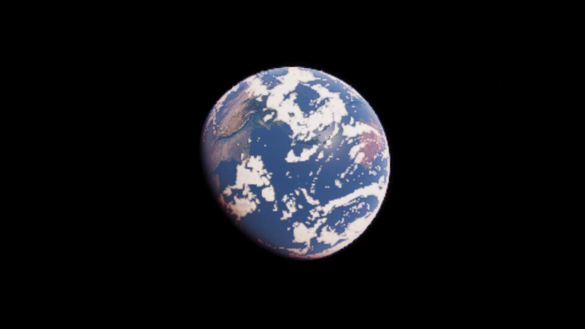 Earth-like planet, clouds and terminator | 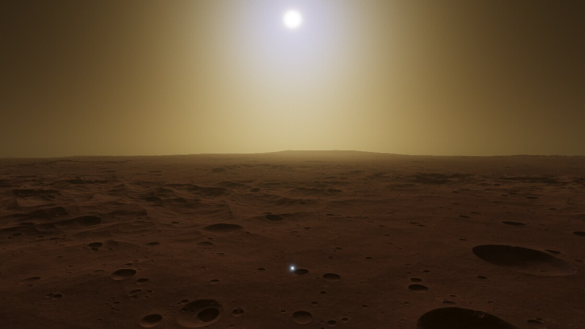 Mars surface, dust sky with blue solar aureole |
| 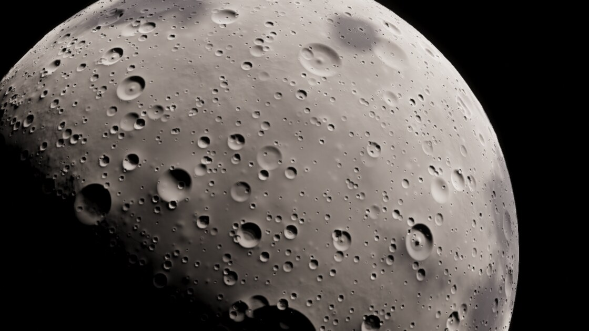 Moon near the terminator | 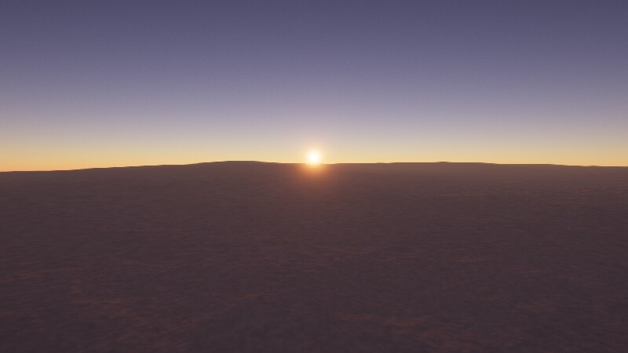 Sunset on Earth |
| 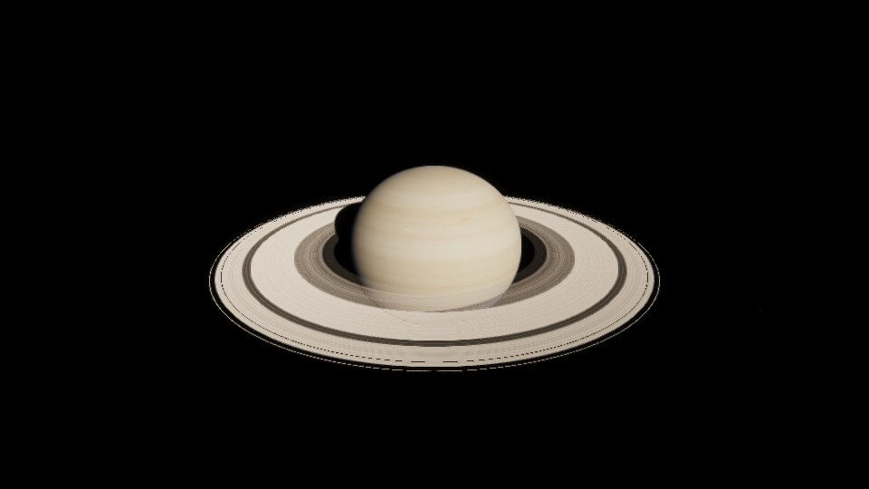 Saturn in 2017 | 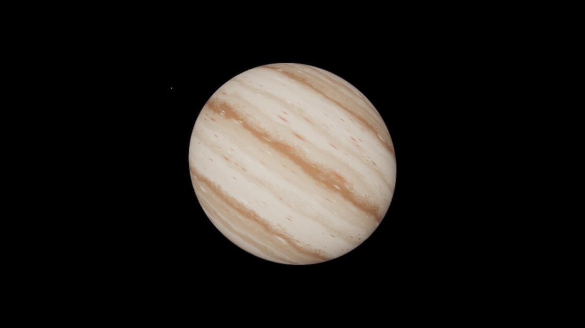 Jupiter |
| 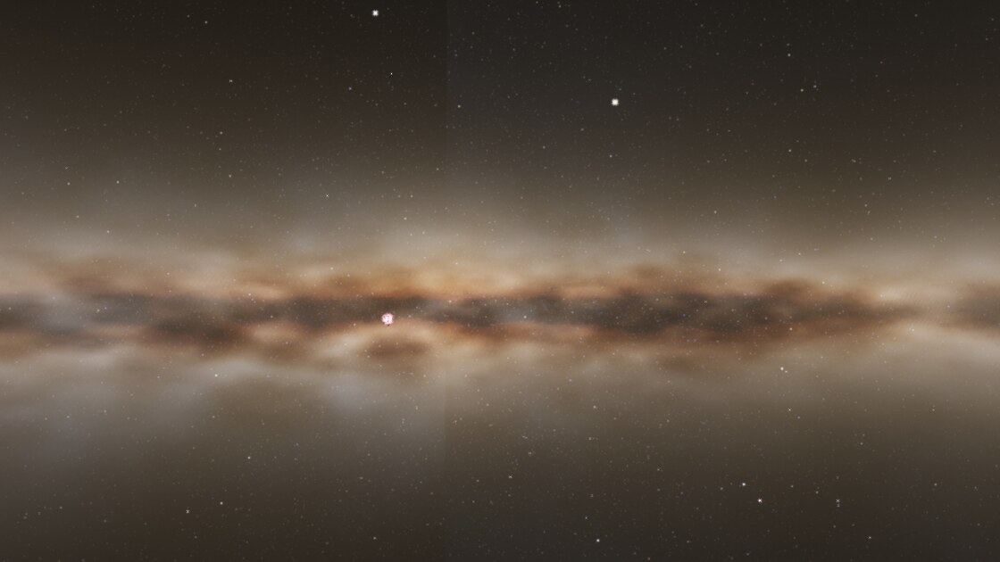 Milky Way from the Solar System | 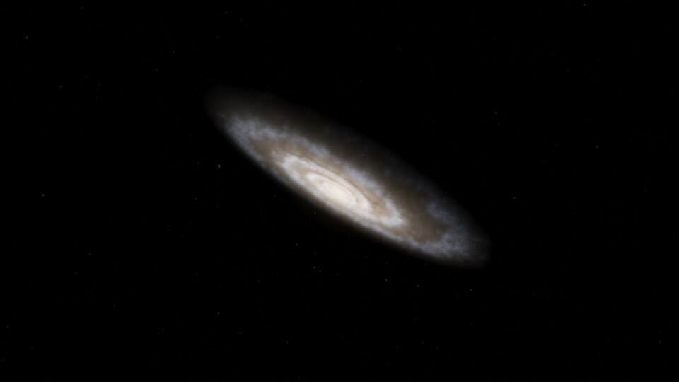 Andromeda |
| 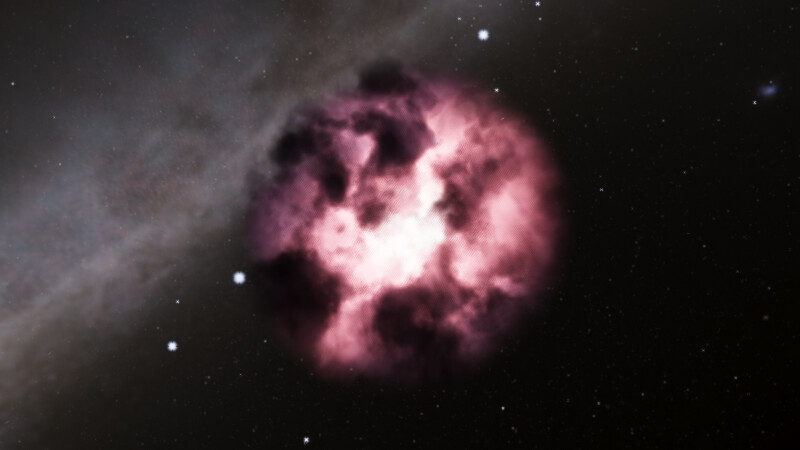 Orion Nebula | 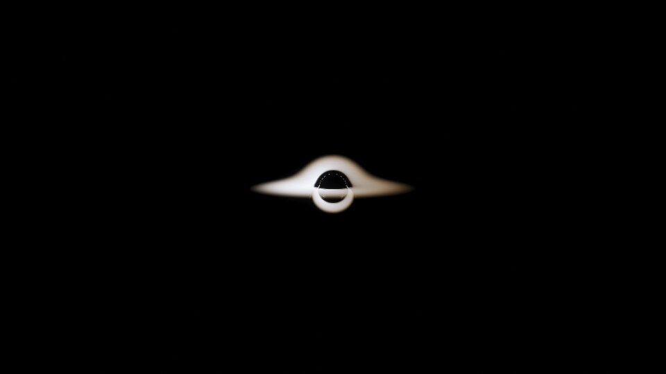 Sagittarius A* |
| 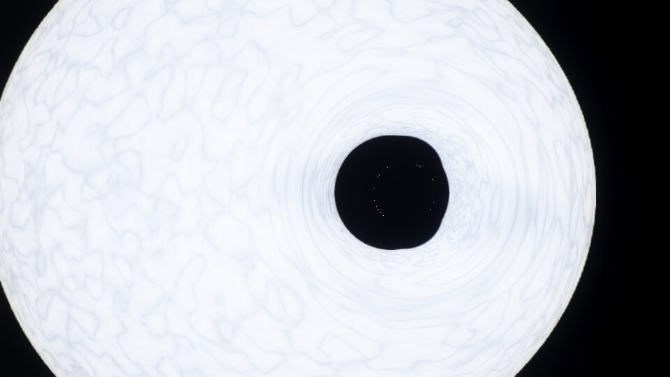 Cygnus X-1 lensing its supergiant companion | 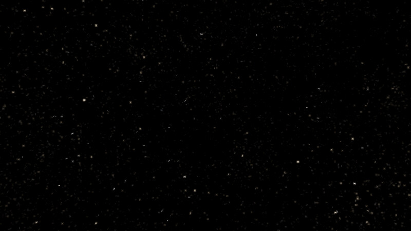 Intergalactic deep field |
| 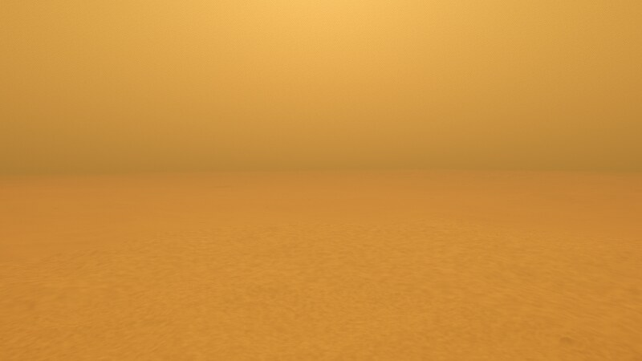 Surface of Titan under its haze | 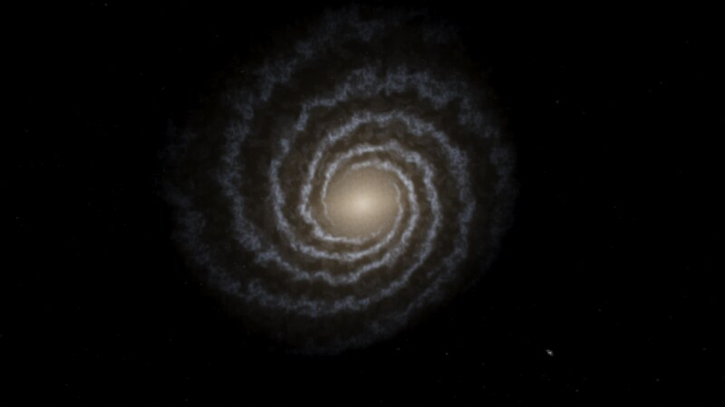 Milky Way from above |
| 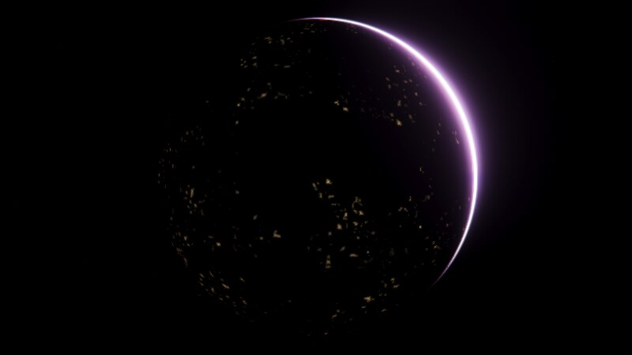 City lights on the night side | 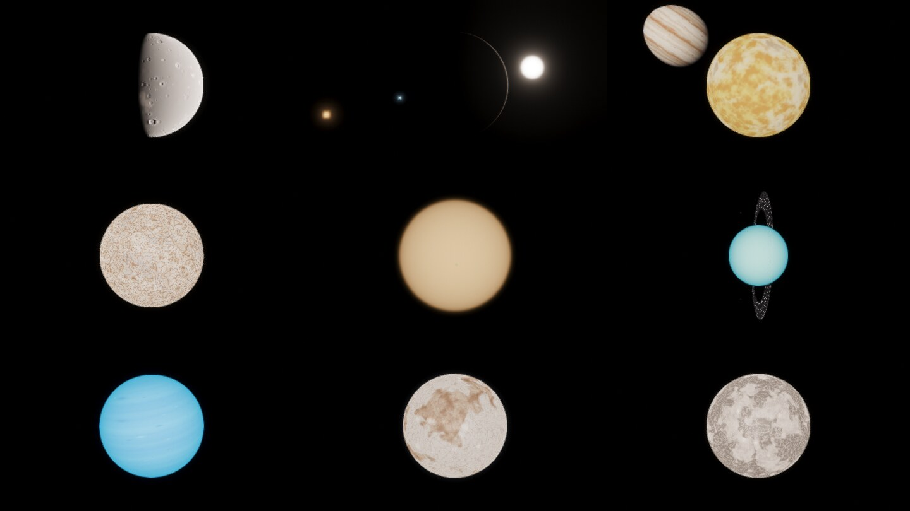 Mercury, Venus, Io, Europa, Titan, Uranus, Neptune, Pluto, Ganymede |

## Run

    cd ~/projects/cosmos
    ./run.sh          # serves http://localhost:8642/
    ./run.sh show     # also opens it on the desktop session (display :20)

Needs a browser with WebGL2 and float render targets (any desktop Chrome, Firefox or Edge with a GPU).
Quality presets: add `?q=low`, `?q=medium` or `?q=high` (default). Dynamic resolution is on by default.
Start somewhere else with `?goto=Saturn&date=2017-06-01` (any name the search box accepts).

## Controls

| Input | Action |
| --- | --- |
| Left drag | Look around |
| Right drag | Orbit the selected object |
| Wheel | Change flight speed (Ctrl + wheel zooms to the selection) |
| W A S D, R F | Fly (Shift faster, Ctrl slower) |
| Q E, arrows | Roll, turn |
| Click, double click | Select, go to |
| G, L, C | Go to, land on, look at the selection |
| T | Guided tour (T again for the next stop, Esc to stop) |
| Space, `,` `.` J `\` | Pause, slower, faster, reverse, real time |
| 0 to 9 | Sun, Mercury ... Pluto |
| Tab | System browser |
| O, N | Orbits, labels |
| `[` `]` | Exposure |
| Z, X | Zoom the field of view |
| F2, P | Hide the interface, save a screenshot |
| H | Help |

On touch screens: one finger looks around, pinch moves toward or away from the selection, and two on-screen buttons fly forward and back.

The Places menu jumps to planets, nebulae, black holes and galaxies. Explore picks a random star.

## What is simulated

- **Scale hierarchy.** Camera position is kept at three levels (Mpc in the universe, parsecs in a galaxy,
  metres in a star system) in double precision, and everything is drawn relative to the camera.
- **Large scale structure.** Galaxies are generated in a cosmic web (filaments, clusters, voids) with Hubble types
  (E, S0, S, SB, Irr). The Local Group and a few famous galaxies are placed at their real positions.
- **Galaxies.** One volumetric light model (bulge, bar, disk, logarithmic spiral arms, young blue populations,
  HII regions, dust with reddening) is ray marched both for distant galaxies and for the sky seen from inside.
- **Stars.** Generated from the local luminosity function in magnitude-binned grids, with main sequence, giant,
  supergiant, white dwarf, neutron star and black hole populations. Brightness is photometric: apparent magnitude
  to flux to pixel energy, with blackbody colours.
- **Star systems.** The Solar System uses real orbital elements, masses, radii, tilts and atmospheres (planets,
  25 moons, dwarf planets, Halley's comet, belts). Other systems are generated: binaries, rocky planets, gas and ice
  giants, moons, rings, belts, with mass-radius relations, equilibrium temperature, greenhouse and atmosphere retention.
  All bodies move on Kepler orbits and rotate; time can run from real time to millions of years per second.
- **Planet surfaces.** A quadtree cube-sphere with GPU baked tiles (height, normals, albedo). Noise is evaluated
  per octave in tile-local coordinates supplied in double precision, so detail holds from orbit down to centimetres.
  Continents, shelves, mountain belts with erosion-like ridges, hills, dunes, craters, maria, ice fractures, lava,
  climate-driven biomes, snow, sea ice and city lights.
- **Atmospheres.** Physically based scattering (transmittance, multiple scattering and sky irradiance LUTs after
  Hillaire 2020), with Rayleigh and Mie coefficients derived from pressure, temperature, gravity and composition.
  Ozone and methane absorption, dust with wavelength-dependent phase (blue Martian sunsets), planet shadow, eclipses.
- **Clouds.** Volumetric ray marched cloud layer driven by a baked weather map with cyclones.
- **Water.** Depth-dependent absorption and scattering, Fresnel reflection, sun glint, animated waves up close.
- **Gas giants.** Zonal bands with turbulence and storms, oblate shape, rings with planet shadow and ring shadow.
- **Stars up close.** Limb darkening, granulation, spots, corona and prominences (visible during eclipses).
- **Black holes.** Ray traced Schwarzschild geodesics with lensing of the background, photon ring, and an accretion
  disk with Doppler beaming and gravitational redshift. Sagittarius A* and Cygnus X-1 are included.
- **Nebulae.** Volumetric emission nebulae, planetary nebulae and supernova remnants.
- **Camera.** HDR pipeline with auto exposure, bloom, diffraction spikes, ACES tone mapping, FXAA.

## Layout

    index.html
    src/main.js        entry point, quality settings, test hooks
    src/nav.js         camera, world state, go-to, picking, level transitions
    src/render.js      frame pipeline and post processing
    src/planet.js      tile quadtree and surface shading
    src/terrain_glsl.js  surface generators (rocky, gas giant, star)
    src/atmosphere.js, src/atmo_glsl.js  scattering and clouds
    src/sky.js         galaxies, galaxy sky cubemap, star points
    src/starfield.js, src/stars.js   star generation and stellar physics
    src/system.js      Solar System data, procedural systems, orbits
    src/universe.js    galaxy catalogue and galaxy light model
    src/extras.js      rings, orbit lines, asteroid belts
    src/exotic.js      black holes, coronae, nebulae
    src/ui.js, src/ui.css  interface
    tools/shot.mjs     headless screenshot harness (puppeteer-core + SwiftShader)

## Testing

    cd tools && npm i
    ./s.sh earth "" 800 450            # screenshot into ../shots/earth.png
    ./s.sh mars "nav.goTo(c.findByName(nav,'Mars'),{dur:0.01});"

The harness runs frames until tile baking and exposure have settled, then saves a PNG.

## Decisions and limits

- Raw WebGL2 was chosen over WebGPU so it runs everywhere and can be tested headless here.
- This machine has no GPU. Everything was checked with SwiftShader at reduced settings, so frame rate and
  driver behaviour on real GPUs are untested. If it is slow, use `?q=low`; dynamic resolution also kicks in below 24 fps.
- Earth is procedural (Earth-like, not the real continents). Other Solar System bodies are tuned look-alikes with
  real sizes, orbits, pole directions and atmospheres.
- Brightness is physical, so a sunlit planet hides the stars and deep space needs long exposures. Auto exposure
  handles this; `[` and `]` bias it. Galaxy and nebula surface brightness is boosted about 20 times to be visible.

## Known gaps

- Terrain shadows are traced inside one tile only, so very long shadows can end at tile borders.
- No vegetation, rocks or other meshes on the ground. Plains look flat from low altitude.
- Clouds are a single volumetric layer driven by a baked weather map. From orbit they read as fairly flat sheets.
- A faint vertical seam can show in the Milky Way glow where two faces of the sky cubemap meet.
- Comet tails are camera-facing ribbons and look wrong from inside the tail.
- Distant galaxies in the deep field are drawn as small blobs and can look like stars.
- Auto exposure can hunt for a second or two when a very bright point source enters the frame.
- No real star catalogue (only the Sun, Sgr A* and Cygnus X-1 are placed by hand), no relativistic effects apart from
  black hole lensing, and orbits are Keplerian rather than n-body.
- The default `?q=high` settings could not be smoke tested end to end here: the first frames take minutes on the software
  renderer. Each setting was exercised separately in the gallery renders, and `tools/live.mjs` passes at reduced settings.
- The 1120x630 sunset render for the gallery timed out on the software renderer. The gallery uses the 800x450 one.
