# Cosmos

A universe at 1:1 scale that runs in the browser (WebGL2, no build step, no dependencies): the real Solar System,
real stars and nebulae around the Sun, and a procedural galaxy and universe beyond. You can fly from a planet's
surface out to intergalactic space without a loading screen.

**Play it:** https://matthewjbarnett.github.io/cosmos/ (press T for a guided tour, H for help)

## Gallery

Unedited frames from the app, rendered headless on a machine without a GPU (software renderer, reduced settings).

| | |
| --- | --- |
|  Earth with real colour, elevation and clouds | 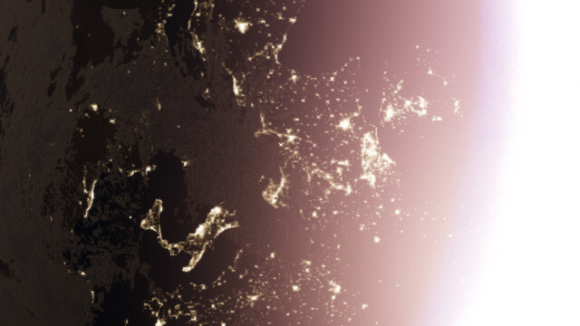 Europe at night (Black Marble city lights) |
| 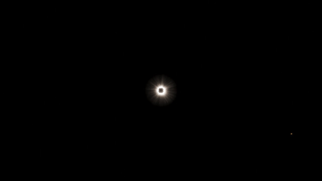 Totality, 8 April 2024, from the computed centreline | 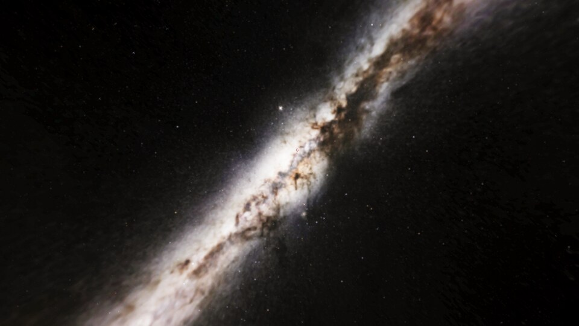 The real Milky Way core from the Atacama |
| 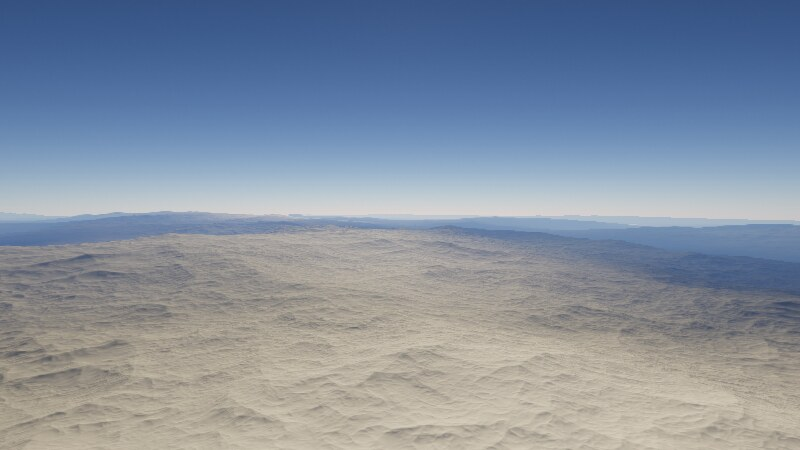 The Alps: real elevation plus procedural detail | 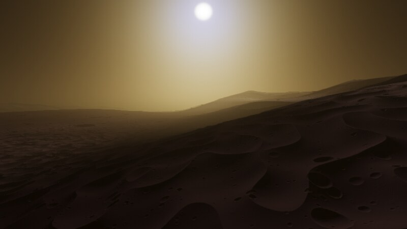 Valles Marineris in the afternoon |
| 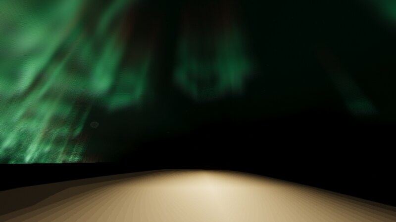 Aurora over northern Canada | 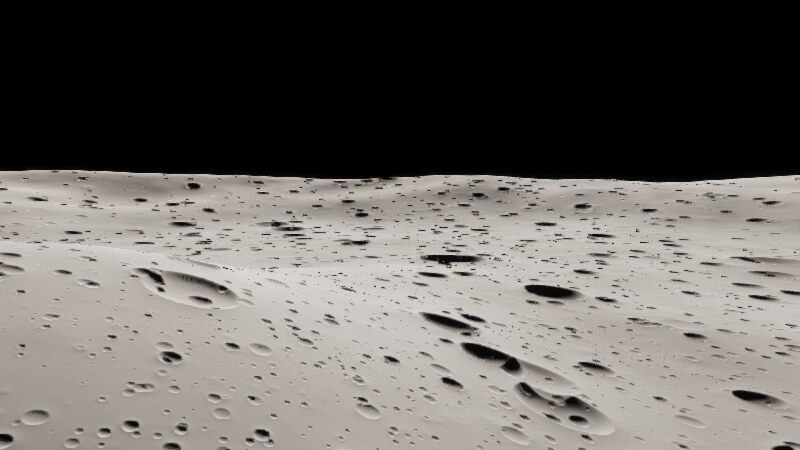 Near Tycho, Earth in the sky |
|  Saturn in 2017 with Cassini ring transparency | 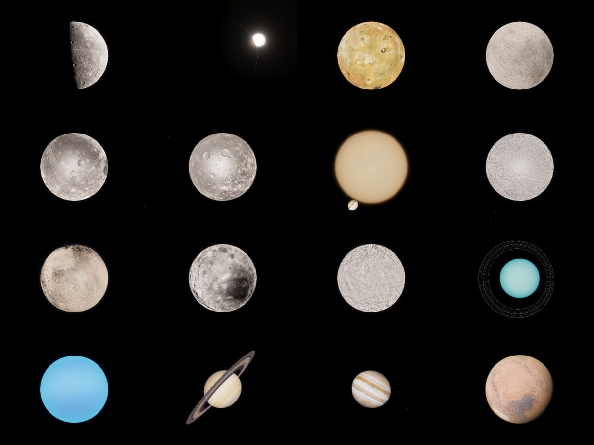 Mercury to Mars from real maps |
| 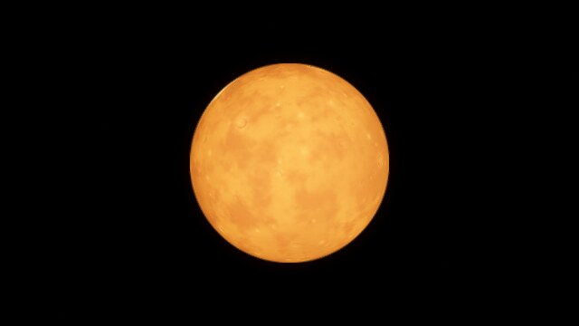 TRAPPIST-1 e under its red dwarf |  Sagittarius A* |
|  Cygnus X-1 lensing its supergiant companion |  Orion Nebula |
|  Andromeda |  The Milky Way from above |
| 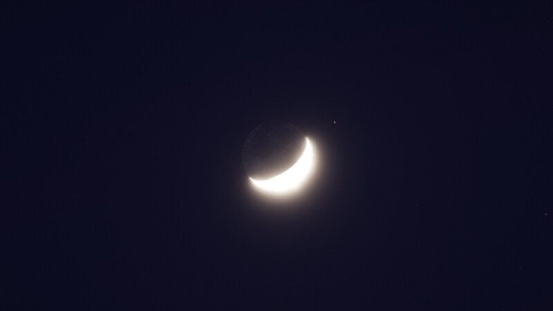 Crescent Moon at dusk, 12 May 2024, with earthshine | 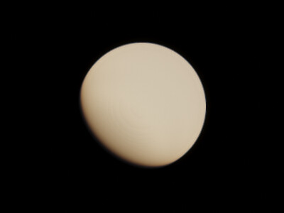 Venus |
| 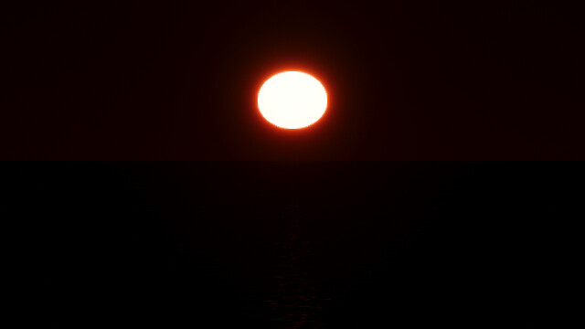 Sunset over the Atlantic: refraction lifts and flattens the Sun | 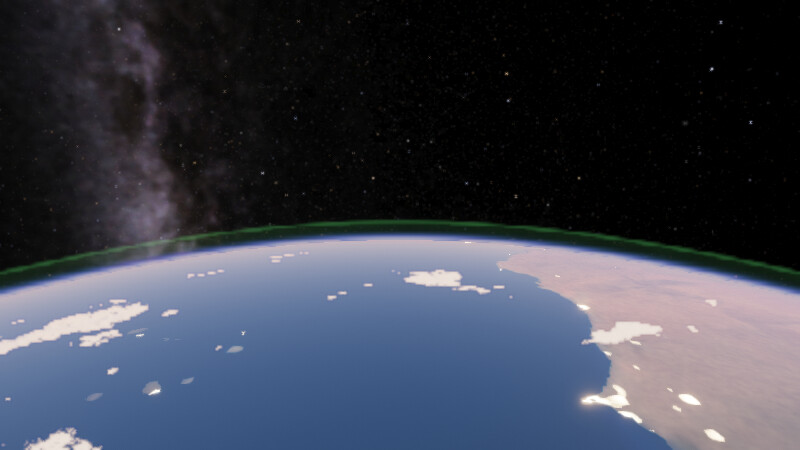 Moonlit night from orbit with airglow |
| 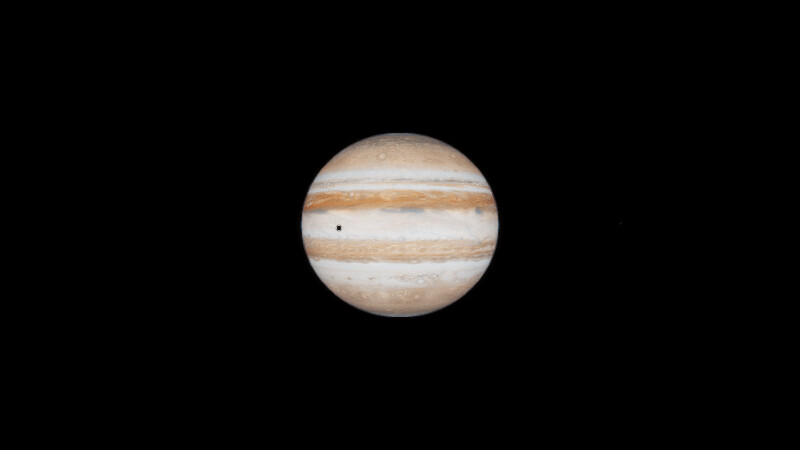 Io's shadow on Jupiter, 20 October 2026 | 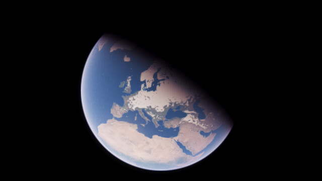 Europe in January |
| 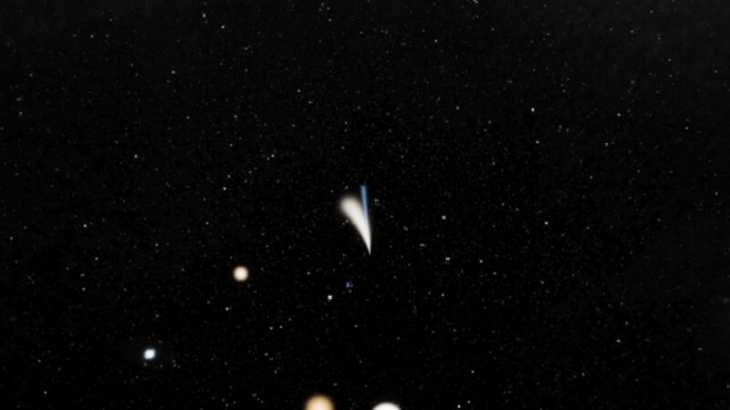 Halley's Comet, February 1986: dust and ion tails | 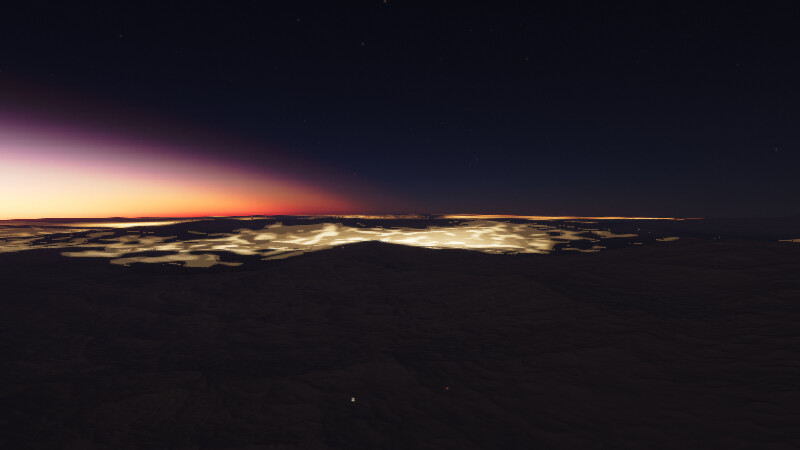 Dusk over the Alps |
| 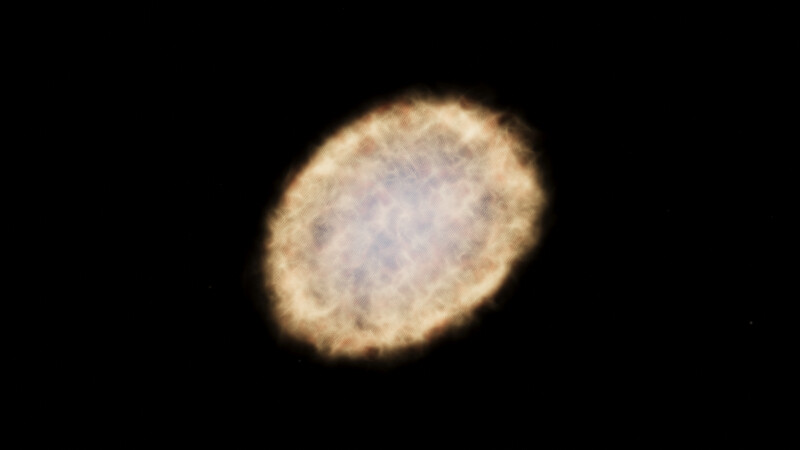 Crab Nebula with its pulsar | 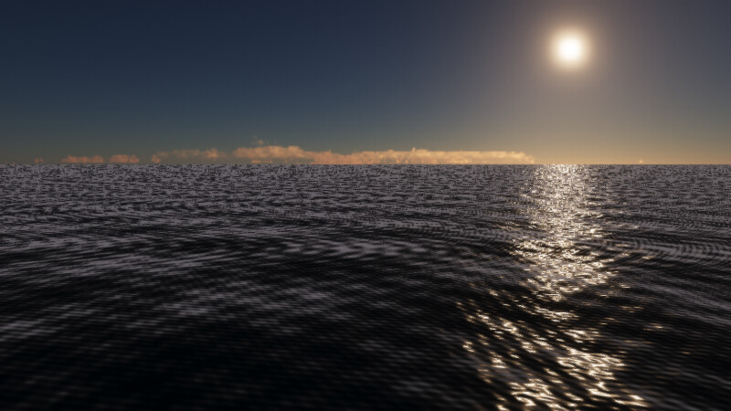 Open ocean in the late afternoon |
| 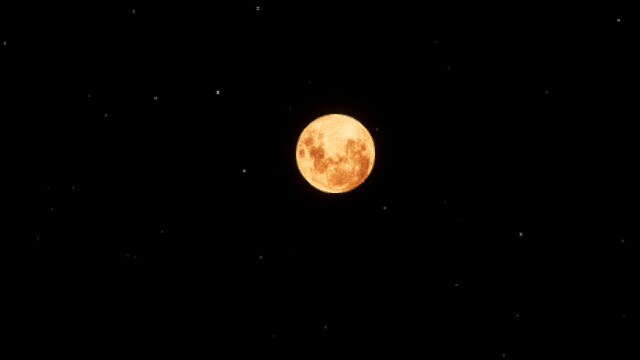 Total lunar eclipse, 14 March 2025, found by the eclipse finder | 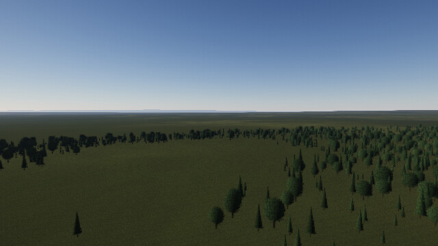 Black Forest from 60 m |
| 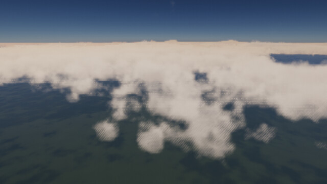 Cumulus over the Amazon from 5 km | 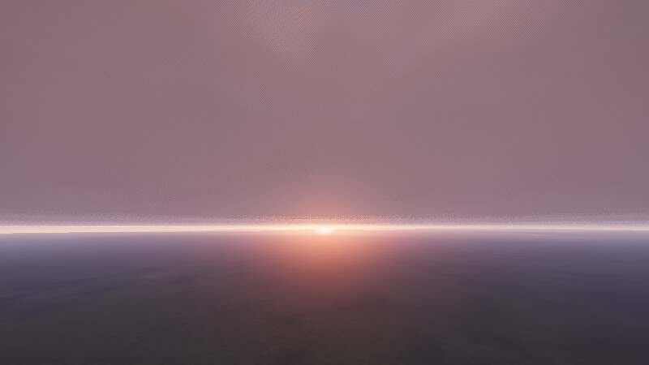 Overcast sunset over Norway |
| 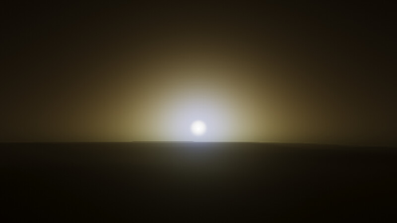 Blue sunset at Gale crater, Mars | 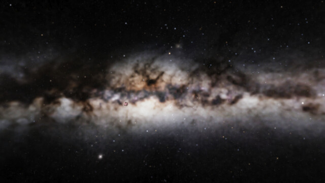 The Milky Way's core from the Solar System |
| 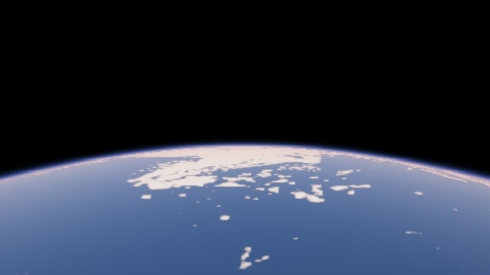 From 400 km over the Atlantic |  Intergalactic deep field |
| 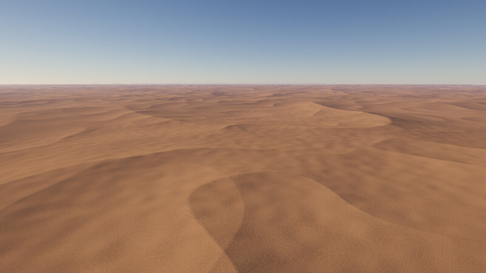 Grand Erg Oriental, Sahara, from 250 m | |

## Run

    cd ~/projects/cosmos
    ./run.sh          # serves http://localhost:8642/
    ./run.sh show     # also opens it on the desktop session (display :20)

Needs a browser with WebGL2 and float render targets (desktop Chrome, Edge, Firefox or Safari with a GPU).
Benchmark: Settings → Run benchmark (or open `?bench`) flies through seven scenes and get a copyable report of frame rate and GPU time per pass.
Quality presets: add `?q=low`, `?q=medium`, `?q=high` (default) or `?q=ultra` (for fast GPUs such as Apple M-series Pro/Max). Dynamic resolution is on by default.
Start somewhere else with `?goto=Saturn&date=2017-06-01` (any name the search box accepts), or on a surface with
`?goto=Earth&land=46.0,7.6&date=2024-06-20T16:30Z` (latitude, longitude). The Link button copies such a URL for where you are.

## Controls

| Input | Action |
| --- | --- |
| Left drag | Look around |
| Right drag | Orbit the selected object |
| Wheel | Change flight speed (Ctrl + wheel zooms to the selection) |
| W A S D, R F | Fly (Shift faster, Ctrl slower) |
| Q E, arrows | Roll, turn |
| Click, double click | Select, go to |
| G, L, C | Go to, land on, look at the selection |
| T | Guided tour (T again for the next stop, Esc to stop) |
| Space, `,` `.` J `\` | Pause, slower, faster, reverse, real time |
| 0 to 9 | Sun, Mercury ... Pluto |
| Y | Orbit mode: enter a circular orbit, W A S D R F fire thrusters (Newtonian two-body motion) |
| Shift+E | Next eclipse: jumps to the next central solar or umbral lunar eclipse and watches it from the centreline (or under the Moon) |
| B | Save the current view (Saved menu) |
| Tab | System browser |
| O, N, K | Orbits, labels, constellation figures |
| `[` `]` | Exposure |
| Z, X | Zoom the field of view |
| F2, F3, P | Hide the interface, GPU timings per pass, save a screenshot |
| H | Help |

On touch screens: one finger looks around, pinch moves toward or away from the selection, and two on-screen buttons fly forward and back.

The Places menu jumps to planets, exoplanet systems, nebulae, black holes and galaxies. Explore finds a random star,
an Earth-like planet with life, a ringed planet, a giant star or another galaxy. The Saved menu keeps views you save with B.

## What is simulated

**Real data**
- **Stars:** 91,793 stars from the HYG catalogue (to magnitude 9.5) at their real 3D positions, with names,
  spectral types, search and visits. Constellation figures (K) are drawn in 3D, so they distort as you travel.
  Procedural stars fill in only where the catalogue is incomplete.
- **Solar System surfaces:** Earth (Blue Marble colour, ETOPO elevation and bathymetry, coastlines, Black Marble city
  lights, real cloud cover), the Moon (LROC colour, LOLA elevation), Mars (Viking colour, MOLA elevation), Mercury,
  Io, Europa, Ganymede, Callisto, Titan, Enceladus, Pluto, Charon, Ceres, the giant planets and Saturn's rings.
  Grayscale mosaics are calibrated to each body's real albedo. Procedural detail continues below map resolution
  (forest and fields, rock on steep slopes, snow line, ridges).
- **Eclipse finder (Shift+E):** finds solar and lunar eclipses, including partial and penumbral ones (2024 to 2026 checked
  against NASA: times within about a minute) and takes you to watch it. The eclipsed Moon is lit red by light refracted
  through Earth's atmosphere.
- **Ephemerides:** planets from JPL approximate elements with secular rates, the Moon from Meeus' lunar theory,
  Jupiter's Galilean moons from Meeus ch. 44, IAU pole directions and prime meridians, Earth rotation from sidereal
  time. Phases and eclipses happen when they really do: eclipse paths land within ~20 to 65 km of NASA's
  greatest-eclipse points for 2017, 2024, 2026 and 2027.
- **Exoplanets:** observed systems at Proxima Centauri, TRAPPIST-1, Barnard's Star, 51 Pegasi, Epsilon Eridani and
  Tau Ceti; Sirius B; asteroids and dwarf planets (Vesta, Pallas, Hygiea, Juno, Eros, Bennu, Makemake, Haumea, Sedna).
- **Milky Way from near the Sun:** the ESO all-sky panorama with point stars removed, blended into the procedural
  galaxy model a few hundred parsecs out.

**Simulation and rendering**
- **Scale hierarchy:** camera position is kept at three levels (Mpc, parsecs, metres) in double precision and
  everything is drawn relative to the camera, from 1.7 m above a surface to intergalactic space.
- **Procedural universe:** galaxies in a cosmic web with Hubble types, stars from the luminosity function in
  magnitude-binned grids, and star systems with binaries, rocky and giant planets, moons, rings and belts.
- **Planet surfaces:** a quadtree cube-sphere with GPU baked tiles; noise is evaluated per octave in tile-local
  coordinates supplied in double precision, so detail holds down to centimetres.
- **Atmospheres:** physically based scattering (Hillaire 2020 LUTs) with coefficients from pressure, temperature,
  gravity and composition; ozone and methane absorption; Martian dust with wavelength-dependent phase; planet shadow,
  eclipses and cloud shadows in the air (crepuscular rays).
- **Clouds:** volumetric ray marching driven by the real cloud map on Earth (Earth-like exoplanets borrow its
  morphology), cloud cells whose area matches the observed cover, billowy cumulus from GPU-baked Worley noise, light
  marched through the whole layer (overcast bases stay grey at sunset), lightning in storm clouds at night.
- **Ground:** dune fields wherever the real map shows sand seas; instanced trees where the land is green (stands, clearings, conifers and broadleaf), boulders on barren
  ground, degraded small craters, ice and snow textures, triaxial shapes for small moons and asteroids.
- **Oceans:** a directional wind-wave spectrum near the camera that becomes microfacet roughness with distance,
  Fresnel reflection of a horizon-weighted sky, the sun's glitter path, depth-dependent colour.
- **Seeing from the ground:** astronomical refraction lifts and flattens the setting Sun and Moon and raises stars
  near the horizon; stars twinkle more near the horizon; light pollution from the real night-lights map glows over
  cities; airglow at 95 km; aurora around the real geomagnetic pole.
- **Seasons:** Earth's snow cover follows the date (continental interiors first, forests show through the snow).
- **Orbit mode (Y):** Newtonian two-body flight with thrusters; a 400 km orbit around Earth takes 92.4 minutes.
- **Lighting:** eclipses with penumbra, ring shadows, terrain self-shadowing and baked ambient occlusion, planetshine
  (earthshine on the Moon, moonlight at night), Lommel-Seeliger scattering on airless bodies.
- **Exotic objects:** ray traced Schwarzschild black holes with Doppler-beamed accretion disks, volumetric nebulae,
  coronae, ray marched comets (coma, curved dust tail, straight ion tail, sized by distance from the Sun), pulsar beams.
- **Camera:** HDR pipeline with centre-weighted auto exposure (switches to the corona during totality, lets a sunlit
  limb blow out to show city lights), bloom, ACES tone mapping and temporal anti-aliasing with sub-pixel jitter.
- **Performance:** shaders compile in parallel behind a loading screen; terrain tiles bake ambient occlusion once; atmosphere and clouds render at half
  resolution with temporal accumulation when they fill the screen; exposure and ground height readbacks are
  asynchronous; the galaxy sky cube rebuilds in strips; dynamic resolution aims for 55+ fps, then trims ray march
  steps and terrain detail if that is not enough.

**Interface:** search (planets, moons, named stars, nebulae, galaxies), Places and Explore menus, guided tour (T),
eclipse finder (Shift+E), orbit mode (Y), saved views (B), system browser, date picker, shareable location links,
latitude/longitude and local solar time, illuminated fraction and moon phase, GPU timing overlay (F3), settings saved
between visits.

## Layout

    index.html
    src/main.js        entry point, quality settings, test hooks
    src/assets.js      map and catalogue loading
    src/ephem.js       planetary, lunar and Galilean ephemerides, IAU rotation
    src/realsystems.js observed exoplanet systems
    src/tour.js        guided tour
    data/              real data (see data/README.md for sources and licences)
    src/nav.js         camera, world state, go-to, picking, level transitions
    src/render.js      frame pipeline and post processing
    src/planet.js      tile quadtree and surface shading
    src/terrain_glsl.js  surface generators (rocky, gas giant, star)
    src/atmosphere.js, src/atmo_glsl.js  scattering and clouds
    src/sky.js         galaxies, galaxy sky cubemap, star points
    src/starfield.js, src/stars.js   star generation and stellar physics
    src/system.js      Solar System data, procedural systems, orbits
    src/universe.js    galaxy catalogue and galaxy light model
    src/extras.js      rings, orbit lines, asteroid belts
    src/exotic.js      black holes, coronae, nebulae
    src/ui.js, src/ui.css  interface
    tools/shot.mjs     headless screenshot harness (puppeteer-core + SwiftShader)
    tools/data/        scripts that rebuild data/ from the original sources

## Testing

    cd tools && npm i
    ./s.sh earth "" 800 450            # screenshot into ../shots/earth.png
    ./s.sh mars "nav.goTo(c.findByName(nav,'Mars'),{dur:0.01});"

The harness runs frames until tile baking and exposure have settled, then saves a PNG.

## Decisions and limits

- Raw WebGL2 was chosen over WebGPU so it runs everywhere and can be tested headless here.
- This machine has no GPU. Everything was checked with SwiftShader at reduced settings, so frame rate on real GPUs
  (including the M5) is untested. Press F3 in the app to see GPU time per pass. If it is slow, use `?q=low`;
  dynamic resolution also lowers the render scale below 48 fps.
- Brightness is physical, so a sunlit planet hides the stars and deep space needs long exposures. Auto exposure
  handles this; `[` and `]` bias it. Galaxy and nebula surface brightness is boosted about 20 times to be visible.
- Asteroid and dwarf planet orbits beyond the main planets use approximate elements, so their positions along the
  orbit are not exact.

## Known gaps

- Real elevation is ~10 km per pixel, so features like the Grand Canyon are not resolved; detail below that is procedural.
- Terrain shadows reach two tile levels out, so the very longest shadows at sunrise can still end abruptly.
- Trees are camera-facing billboards (conifers and broadleaf); there are no rocks, buildings or grass meshes.
- Earth's cloud cover is a single observed snapshot: individual cloud cells drift and change with the wind, but the
  weather systems themselves stay where the map put them.
- Aurora seen from orbit is streaky; from the ground it looks right.
- Eclipse timing and paths are good to tens of kilometres and about a minute (no nutation, truncated lunar series).
- Galaxies other than the Milky Way and nebulae other than the six named ones are procedural.
