# Cosmos

A universe at 1:1 scale that runs in the browser (WebGL2, no build step, no dependencies): the real Solar System,
real stars and nebulae around the Sun, and a procedural galaxy and universe beyond. You can fly from a planet's
surface out to intergalactic space without a loading screen.

It is also a physics simulation across all of time: merge black holes and hear the gravitational waves, form the
Moon in a giant impact, detonate white dwarfs (V for the sandbox); fast-forward to watch ice ages come and go, the
continents drift, Betelgeuse explode, the Sun circle the Galaxy, Andromeda collide with the Milky Way, the Sun become
a red giant and the other galaxies recede beyond our horizon (U for the timeline). Rewind and it all runs backwards:
Pangaea reassembles, the magnetic field flips, Andromeda recedes towards its turnaround, stars and nebulae return to the
clouds they formed from, and the young galaxies light up with quasars. PgUp and PgDn step through the events.

**Play it:** https://matthewjbarnett.github.io/cosmos/ (press T for a guided tour, H for help)

## Gallery

Unedited frames from the app, rendered headless on a machine without a GPU (software renderer, reduced settings).

| | |
| --- | --- |
|  Earth with real colour, elevation and clouds |  Europe at night (Black Marble city lights) |
|  Totality, 8 April 2024, from the computed centreline |  The real Milky Way core from the Atacama |
|  The Alps: real elevation plus procedural detail |  Valles Marineris in the afternoon |
|  Aurora over northern Canada |  Near Tycho, Earth in the sky |
|  Saturn in 2017 with Cassini ring transparency |  Mercury to Mars from real maps |
|  TRAPPIST-1 e under its red dwarf |  Sagittarius A* |
|  Cygnus X-1 lensing its supergiant companion |  Orion Nebula |
|  Andromeda |  The Milky Way from above |
|  Crescent Moon at dusk, 12 May 2024, with earthshine |  Venus |
|  Sunset over the Atlantic: refraction lifts and flattens the Sun |  Moonlit night from orbit with airglow |
|  Io's shadow on Jupiter, 20 October 2026 |  Europe in January |
|  Halley's Comet, February 1986: dust and ion tails |  Dusk over the Alps |
|  Crab Nebula with its pulsar |  Open ocean in the late afternoon |
|  Total lunar eclipse, 14 March 2025, found by the eclipse finder |  Black Forest from 60 m |
|  Cumulus over the Amazon from 5 km |  Overcast sunset over Norway |
|  Blue sunset at Gale crater, Mars |  The Milky Way's core from the Solar System |
|  From 400 km over the Atlantic |  Intergalactic deep field |
|  Grand Erg Oriental, Sahara, from 250 m |  Sandbox: 36 + 29 M☉ black holes a second before merging, lensing their own trails and the spacetime grid |
|  An eccentric black hole binary: general relativity turns the orbit into a rosette |  Mars 45 million years from now, ringed by the debris of Phobos |
|  Betelgeuse goes supernova (~100,000 years from now), seen from Earth |  The red giant Sun over Mars, 7.6 billion years from now |
|  The Sun's planetary nebula around its newborn white dwarf |  Milky Way and Andromeda after their first passage (N-body) |
|  Andromeda looming in the sky of the Solar System in 3.4 billion years |  The Sun's orbit around the Milky Way |
|  A rogue black hole crosses the Solar System: the planets' trails 15 years later |  Flying at 0.9 c: the sky crowds forward, blueshifted and beamed |
|  20,000 years ago: ice sheets over North America, the sea 120 m lower (Milankovitch model) |  80 million years from now: Australia has drifted north into the western Pacific |
|  Sandbox: hours after Theia hits the young Earth, molten rock winds into a disk |  12 ms before a black hole merger: light traced through both holes at once, their shadows fuse |
| 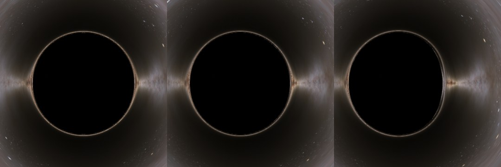 Black hole shadows at spin 0, 0.5 and 0.94: the D shape of a fast spinning (Kerr) hole | 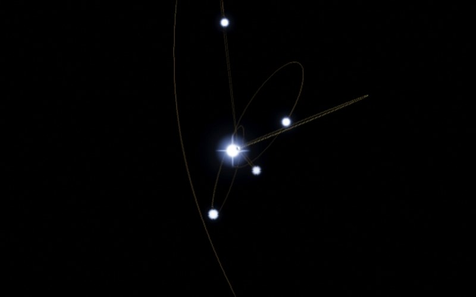 The S-stars around Sagittarius A* in 2018: S2 at its 120 AU pericentre |
| 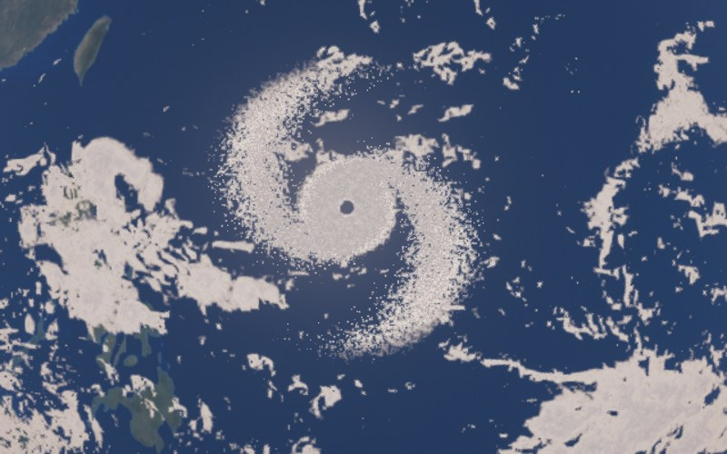 A typhoon over the Philippine Sea in August: eye, central dense overcast and rain bands | |
| 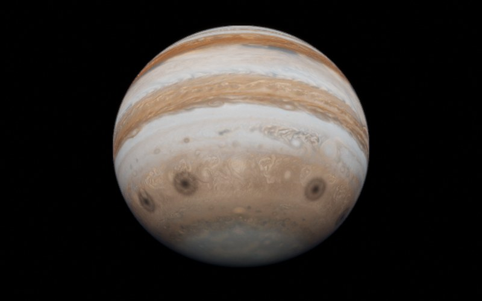 Jupiter on 25 July 1994, scarred by the fragments of Comet Shoemaker-Levy 9 | 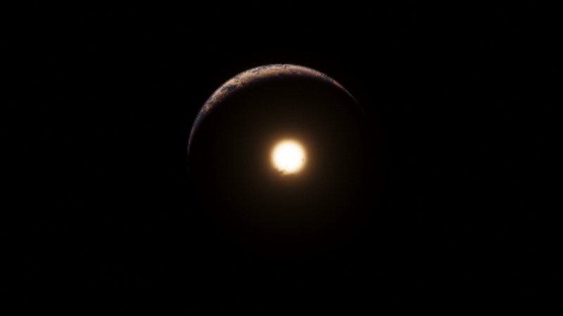 66 million years ago: the fireball of the Chicxulub impact on Earth's night side |
| 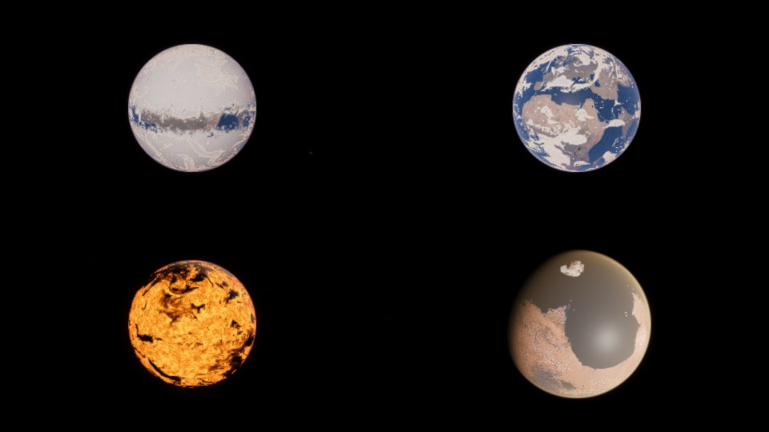 Snowball Earth (690 Myr ago), bare continents (520 Myr ago), the magma ocean (4.5 Gyr ago) and the ancient ocean of Mars | 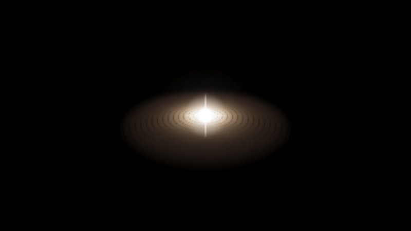 The newborn Sun in its protoplanetary disk, gaps cleared by forming planets |
| 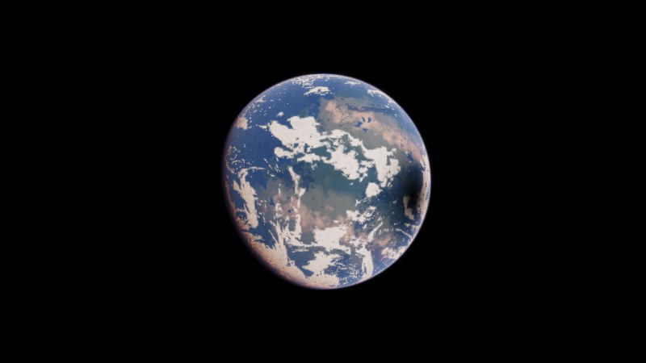 252 million years ago: Pangaea, from the PALEOMAP reconstruction, with arid interior and green coasts | 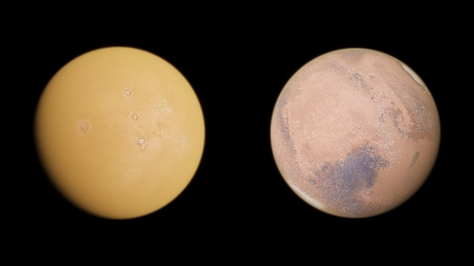 Mars in July 2018 (global dust storm, only the Tharsis volcanoes show) and a year later |
| 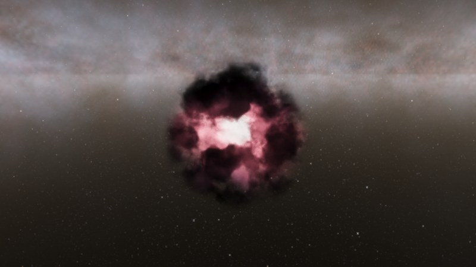 4.575 billion years ago: the molecular cloud where the Sun is about to form | 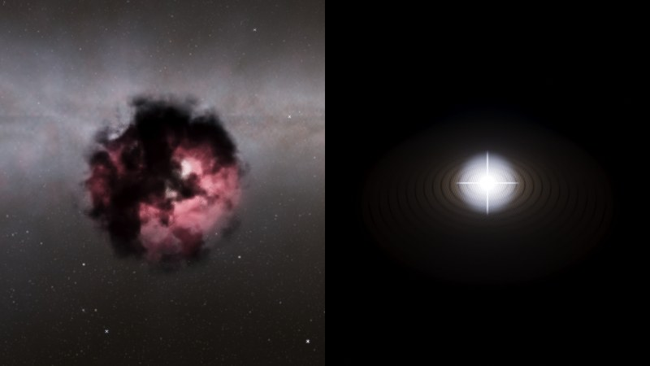 Sirius's birth cloud 178 Myr ago; Vega at 3 Myr old inside its protoplanetary disk |
| 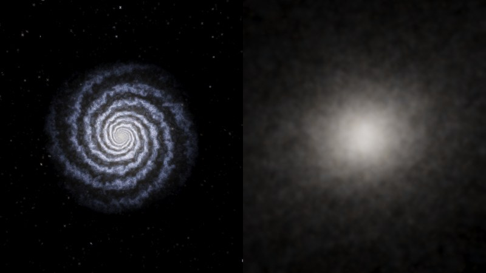 The Milky Way 10 billion years ago (star forming, blue) and Milkomeda 8 billion years from now | 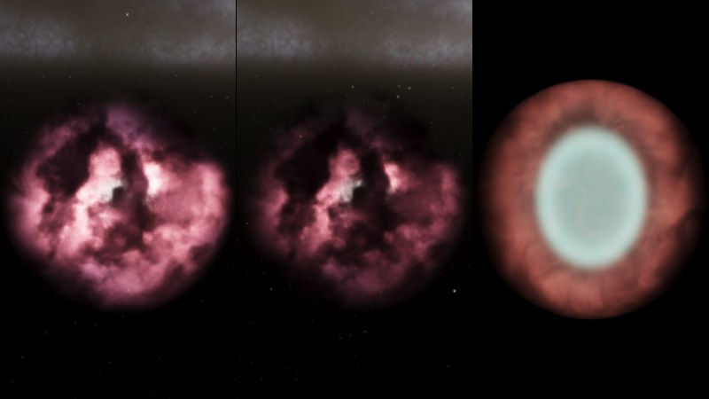 A procedural H II region at 2.8 and 4.8 Myr old (dispersing), and a young planetary nebula |
| 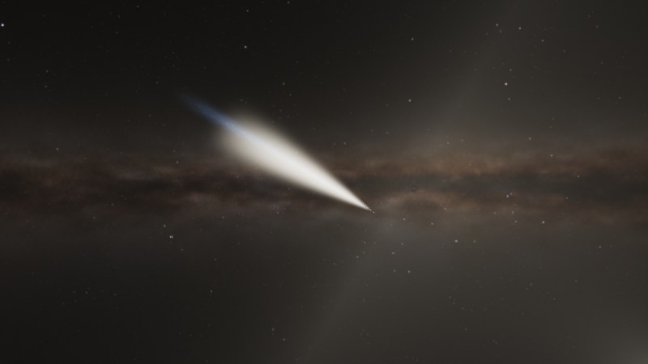 Comet Hale-Bopp, March 1997, on its real orbit: dust tail and blue ion tail | 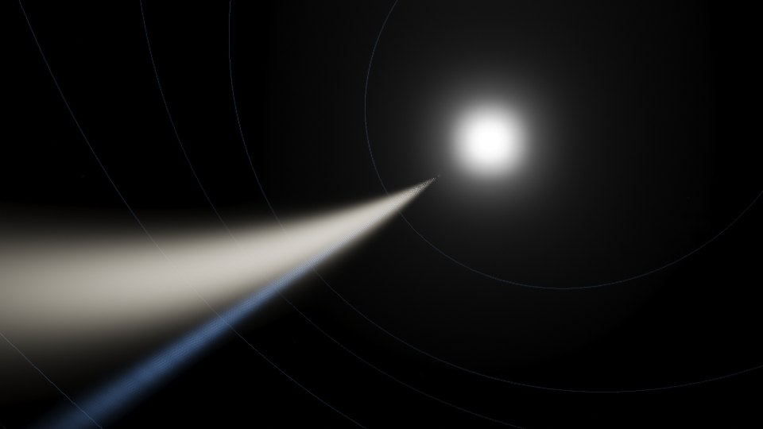 The Great September Comet of 1882, a Kreutz sungrazer, at perihelion beside the Sun (JPL orbit) |
| 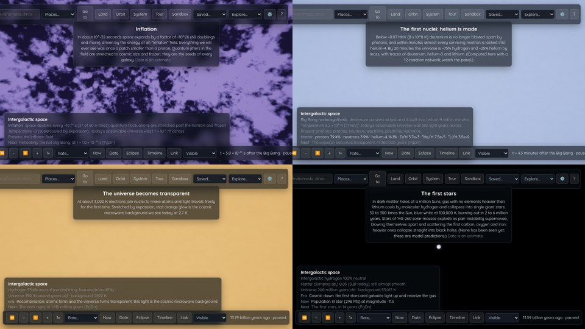 The first moments: inflation (10⁻³⁴ s), helium forming at 4.3 minutes (computed abundances in the HUD), recombination at 390,000 years, the first stars at 200 Myr | 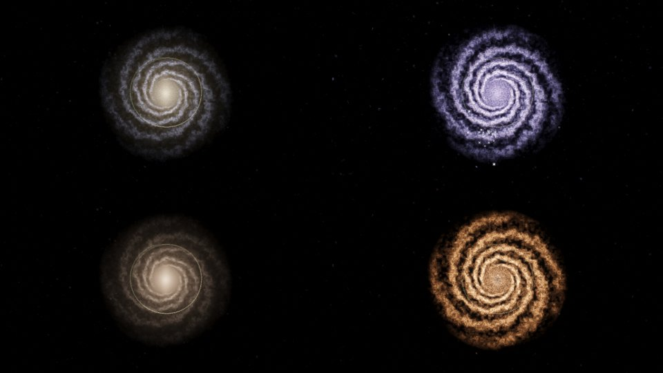 The Milky Way in visible light, ultraviolet (young arms), near-infrared (old stars, dust transparent) and far-infrared (warm dust) |
| 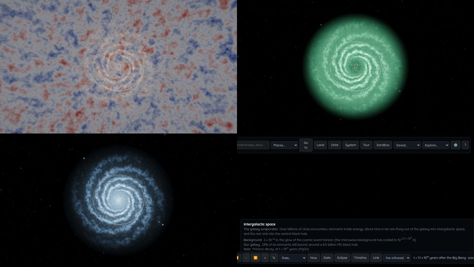 Microwave (the cosmic background), radio (21 cm hydrogen reaching past the stars), X-ray, and remnants glowing in the far infrared 10²⁰ years from now | 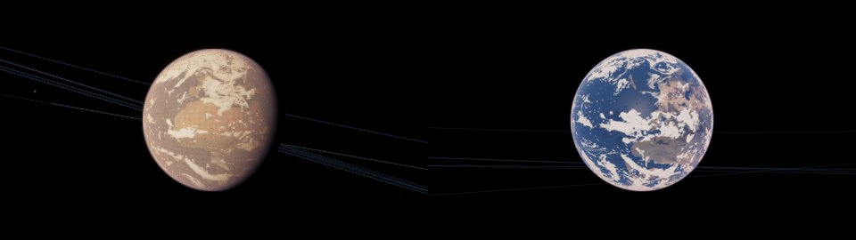 The "pale orange dot" 2.6 billion years ago (Archean organic haze), and an illustrative Rodinia 900 million years ago |
| 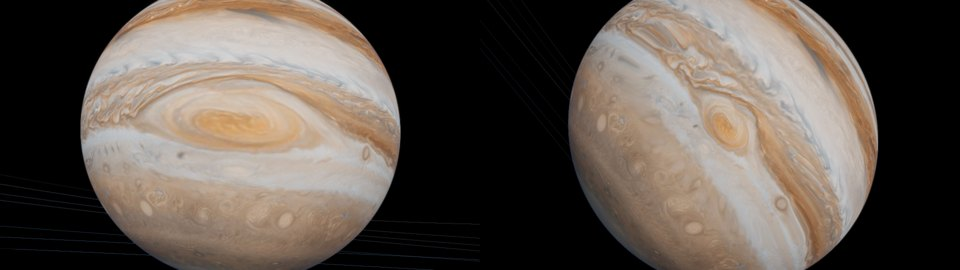 Jupiter's Great Red Spot in 1880 and 2024: the map is stretched by its measured length for the date | 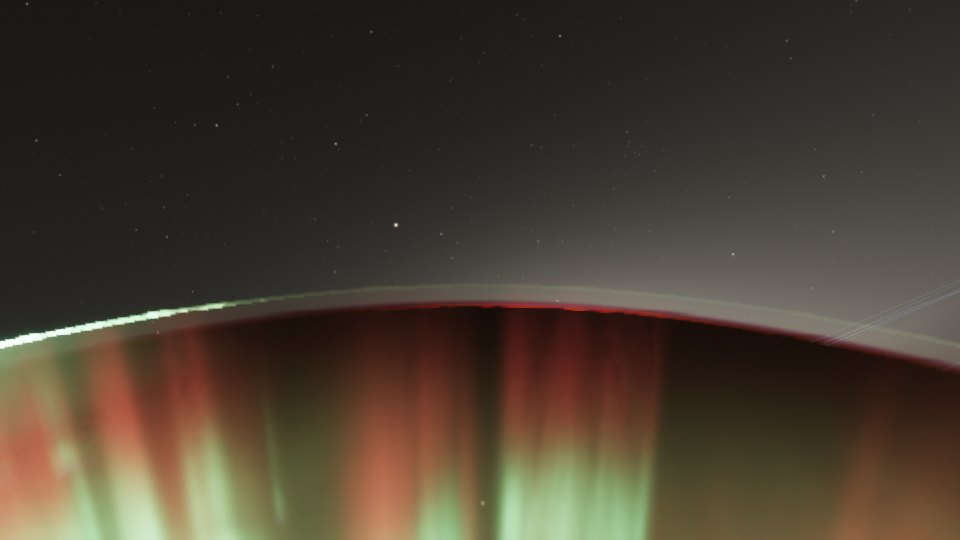 Aurora from 400 km during the storm of 10-11 October 2024 |
| 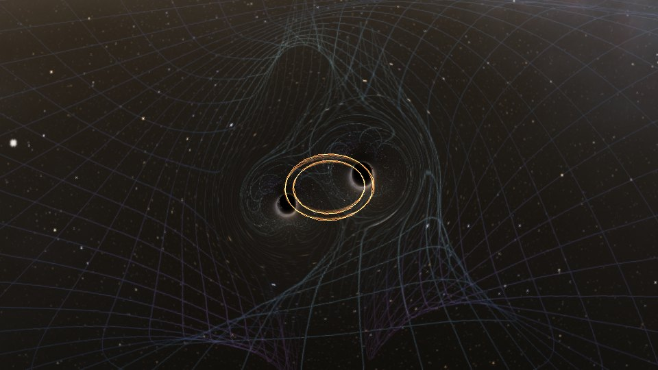 Black holes with tilted spins: the orbital plane precesses (sandbox) | |

## Run

    cd ~/projects/cosmos
    ./run.sh          # serves http://localhost:8642/
    ./run.sh show     # also opens it on the desktop session (display :20)

Needs a browser with WebGL2 and float render targets (desktop Chrome, Edge, Firefox or Safari with a GPU).
Benchmark: Settings → Run benchmark (or open `?bench`) flies through seven scenes and get a copyable report of frame rate and GPU time per pass.
Quality presets: add `?q=low`, `?q=medium`, `?q=high` (default) or `?q=ultra` (for fast GPUs such as Apple M-series Pro/Max). Dynamic resolution is on by default.
Start somewhere else with `?goto=Saturn&date=2017-06-01` (any name the search box accepts), or on a surface with
`?goto=Earth&land=46.0,7.6&date=2024-06-20T16:30Z` (latitude, longitude). The Link button copies such a URL for where you are.

## Controls

| Input | Action |
| --- | --- |
| Left drag | Look around |
| Right drag | Orbit the selected object |
| Wheel | Change flight speed (Ctrl + wheel zooms to the selection) |
| W A S D, R F | Fly (Shift faster, Ctrl slower) |
| Q E, arrows | Roll, turn |
| Click, double click | Select, go to |
| G, L, C | Go to, land on, look at the selection |
| T | Guided tour (T again for the next stop, Esc to stop) |
| Space, `,` `.` J `\` | Pause, slower, faster, reverse, real time (`<` `>` change speed three steps at once, Home returns to the present) |
| PgUp PgDn | Jump to the previous / next event on the timeline from wherever you are in time |
| 0 to 9 | Sun, Mercury ... Pluto |
| Y | Orbit mode: enter a circular orbit, W A S D R F fire thrusters (Newtonian two-body motion) |
| Shift+E | Next eclipse: jumps to the next central solar or umbral lunar eclipse and watches it from the centreline (or under the Moon) |
| I | Observing band: visible, ultraviolet, near-infrared, far-infrared, microwave, radio, X-ray (also a menu in the time bar) |
| U | Timeline from the Planck time to 10¹¹⁰ years (the universe turning transparent, the Milky Way forming, ice ages, Betelgeuse, Andromeda, the Sun's death...) with Go buttons and a Jump box that takes `2 Gyr`, `-65 Myr`, `65 million years ago`, `year 3000` or `age 380 kyr` |
| V | Physics sandbox: black holes, neutron stars, stars and planets under full gravity |
| M | Relativistic flight: speed below c, with aberration, Doppler shift, beaming and time dilation |
| B | Save the current view (Saved menu) |
| Tab | System browser |
| O, N, K | Orbits, labels, constellation figures |
| `[` `]` | Exposure |
| Z, X | Zoom the field of view |
| F2, F3, P | Hide the interface, GPU timings per pass, save a screenshot |
| H | Help |

On touch screens: one finger looks around, pinch moves toward or away from the selection, and two on-screen buttons fly forward and back.

The Places menu jumps to planets, exoplanet systems, nebulae, supernova remnants, interstellar visitors, black holes and
galaxies. Explore finds a random star, an Earth-like planet with life, a ringed planet, a giant star, another galaxy, a
moment in Earth's past or a random event in time. The Saved menu keeps views you save with B. The status panel's "Now"
line lists what is special about the current moment (a Mars dust storm, volcanic haze, a bright comet, a nova).

## Physics and deep time

The clock runs from slow motion (1/1000) to 10 billion years per second (the Rate menu, or `,` and `.`), from the
Big Bang to 100 trillion years from now. The Timeline (U) lists what happens on the way and slows the clock down
for each event (untick "Slow down for events" to race through). Dates marked "estimate" are uncertain in reality.

- **Physics sandbox (V):** pick a scenario or place bodies yourself (click to place on a circular orbit, drag to
  give a velocity). Gravity is N-body with post-Newtonian corrections for every pair: 1PN (precession, the
  innermost stable orbit) and 2.5PN radiation reaction, which shrinks orbits exactly as the Peters formula says.
  Black hole mergers use numerical relativity fits for the radiated energy, final spin, recoil kick and the
  ringdown frequency and damping (GW150914-like masses give 61.9 M☉, spin 0.68, 3.1 M☉ radiated, 275 Hz,
  as measured). The scope shows the strain h₊ at 100 Mpc from the quadrupole formula; Sound plays the chirp.
  The spacetime grid shows each mass's well plus the actual retarded wave field (read at t − r/c), and is bent
  by the black holes' lensing; a pair of holes is ray traced through their combined gravity, so near merger their
  shadows stretch and fuse. Neutron star mergers collapse to a black hole and make a kilonova; stars that pass
  inside a black hole's tidal radius are shredded into debris that falls back at the t^−5/3 rate and lights an
  accretion disk. Stars that touch merge. Time runs backwards too (snapshots, then re-integration).
  Black holes can spin (aligned with the orbit): 1.5PN spin-orbit coupling delays the merger ("orbital hang-up")
  and the remnant spin, radiated energy and recoil follow numerical relativity fits.
  Scenarios: GW150914-like merger, rapidly spinning black holes, unequal masses (recoil), black holes released from rest (head-on), an
  eccentric binary (GR rosette, wave bursts), neutron star merger with kilonova and gamma-ray burst jet,
  a supermassive pair (LISA band), a tidal disruption, a rogue black hole through the real Solar System,
  the figure-eight and Pythagorean three-body problems, a circumbinary planet, the Moon-forming impact, colliding
  white dwarfs, or empty space. White dwarfs that collide above 1.2 M☉ detonate as a Type Ia supernova whose light
  is the decay of nickel-56 and cobalt-56 (peak magnitude −19.1 for 0.6 M☉ of nickel).
  Giant impacts between rocky planets merge them into a molten, fast-spinning body and throw a hot debris disk
  into orbit (about 2% of the mass, after SPH results); material outside the Roche limit gathers into a moon
  within weeks (Ida et al. 1997) while the inner disk spreads and rains back. Selecting a black hole shows its
  Hawking temperature and evaporation time.
- **Moving stars:** catalogue stars follow their measured space velocities (Barnard's Star passes 3.75 ly from
  the Sun in 11,700 years, Alpha Centauri 2.9 ly in 27,600 years, Gliese 710 crosses the Oort cloud in 1.3 Myr),
  so constellations distort; procedural stars stream through the rotating spiral pattern with the Galaxy's
  rotation curve and their own random motions. After a few million years the catalogue fades into the field.
- **The Sun's galactic orbit:** an epicyclic orbit (period 218 Myr, ±290 pc in radius, ±92 pc vertically) drawn
  at galaxy level, with radial migration: the Sun formed ~1.7 kpc further in and drifted out (Minchev et al. 2013); the spiral pattern turns at 25 km/s/kpc, the stars faster, the Solar System keeps its own
  inertial orientation.
- **Supernovae:** massive procedural stars live, explode and are replaced, with light-travel delay, Type II-P
  and Ib/c light curves averaged over each frame (a one-year flash still registers at a million years per
  second), and remnants that expand (free expansion, then Sedov-Taylor) and fade. Betelgeuse (estimated
  100,000 years) and Antares (estimated 600,000 years) explode on schedule: from Earth Betelgeuse peaks at
  magnitude −11, lights the night like a quarter Moon, and if you fly there during the explosion the star swells
  into a fireball tens of AU across before leaving a neutron star. Real nebulae age: the Crab and Veil expand and fade, H II regions disperse in a few Myr.
- **Seen from Earth:** meteor showers on their real dates (Quadrantids, Lyrids, Eta Aquariids, Perseids, Orionids,
  Leonids, Geminids, plus sporadics, more after midnight) streak away from their radiants at ~100 km; zodiacal light
  and the gegenschein glow along the ecliptic at dark sites; city lights and light pollution belong to the era of
  electric lighting.
- **Variable stars:** Algol's eclipses, Mira, Beta Lyrae, Epsilon Aurigae's two-year eclipse every 27 years,
  Zeta Geminorum (a Cepheid) and Betelgeuse's semi-regular pulsation.
- **The Sun's life:** a solar evolutionary track (Sackmann et al. 1993; Schröder & Smith 2008): brightening on
  the main sequence, subgiant, red giant tip at 256 R☉ and 2,700 L☉, the helium flash, horizontal branch,
  AGB, a planetary nebula lit by the contracting core, and a cooling white dwarf. Mass loss widens the planets'
  orbits; Mercury, Venus and Earth are engulfed. Before 4.57 Gyr ago there is no Sun, only its birth cloud.
- **Earth and Moon over time:** precession of the axis (Vega is the pole star in 13,700 CE) and the 41,000 year
  obliquity cycle; tidal recession of the Moon (total solar eclipses end in ~600 Myr) and the lengthening day;
  a brightening Sun dries the oceans (exposing the real sea floor), kills the biosphere and, near the red
  giant tip, heats rock until it glows (Mars too).
- **Orbits over millions of years and ice ages:** beyond ±5,000 years the planets' orbits follow Laplace-Lagrange
  secular theory, solved at load from the masses and orbit sizes (plus general relativity): perihelia and nodes
  precess and eccentricities trade back and forth (Earth's swings between ~0 and 0.06). Midsummer sunlight at
  65° N from the orbit, tilt and precession drives an ice volume model (Imbrie & Imbrie 1980): ice sheets spread
  over Canada and Scandinavia to their Last Glacial Maximum limits and the sea falls up to 125 m, exposing the
  real continental shelves (Beringia, Doggerland, Sundaland). It peaks 18,000 years ago and is clear by 9,000
  years ago, close to the real record. The next glaciation comes ~58,000 years from now (held off for 50,000
  years by human CO₂).
- **Shoemaker-Levy 9** (July 1994): six of the largest fragments leave dark scars at 44 S on Jupiter that spread and
  fade over months.
- **The Chicxulub impact** (66.043 Myr ago): a fireball over Yucatán, an ejecta plume, the whole sky glowing as debris
  re-enters an hour later, then soot spreading around the planet within days and darkening it for years.
- **Earth's deep past:** the Moon begins as a magma ocean and gets its dark maria only 3.9-3.1 Gyr ago; before land plants (~470 Myr ago) the continents are bare; the Cryogenian Snowball Earth
  (~717-635 Myr ago) is frozen to the equator; the first ~70 Myr after formation are a glowing magma ocean; for its
  first ~10 Myr the Sun sits in a flared protoplanetary disk with planet-carved gaps (like HL Tauri); the young
  Sun is fainter, the day shorter and the Moon closer. Mars has
  an ocean in its northern lowlands ~4.1-3.0 Gyr ago, filled to the -3,800 m shoreline on the real MOLA terrain;
  today its seasonal carbon dioxide frost caps spread to ~55 degrees latitude each winter and shrink back in summer.
- **Paleogeography:** before 3 Myr ago Earth's continents, mountains and sea floor are the PALEOMAP reconstructions
  (Scotese & Wright 2018), one every ~5 Myr back to the Cambrian (540 Myr), blended between epochs: Pangaea, its
  breakup, the Tethys and the Western Interior Seaway. Land cover comes from a simple climate: temperature by
  latitude and the epoch's global mean (Scotese et al. 2021; Cretaceous forests reach the poles), Hadley-cell rain
  belts and moisture from the upwind ocean (Pangaea's interior is desert). Events: the Great Dying, Pangaea breaks up.
- **Earth's state through time:** the info panel follows the epoch: global mean temperature, oxygen (none before the
  Great Oxidation 2.4 Gyr ago, ~30% in the Carboniferous) and CO2 (percent-level in the Archean, starving plants
  in ~1 Gyr), and what lives there.
- **Magnetic reversals:** the geomagnetic polarity timescale for the last 5.2 Myr (Brunhes, Matuyama with the
  Jaramillo and Olduvai subchrons, Gauss, Gilbert), the Laschamp excursion 41 kyr ago and the Cretaceous Normal
  Superchron, random reversals (~4 per Myr) elsewhere. While the field is weak the aurora spreads equatorward.
- **The solar cycle:** sunspots and aurorae follow the observed strengths of cycles 1-25 (the giant cycle 19 in
  1958, the weak cycle 24), the Maunder, Spörer and Wolf minima, and random cycles outside the record.
- **Nebulae everywhere live and die:** every procedural H II region, planetary nebula and supernova remnant in every
  galaxy is born, expands (Strömgren t^4/7, coasting shell, Sedov t^2/5) and fades; their birth rates follow the
  star formation history (cosmic noon ~10 Gyr ago at ~3x today, none before the galaxies, H II regions gone once the
  gas runs out). Select one to see its age.
- **Stars before birth:** rewind past a star's birth and it and its planets are gone; for its last ~20 Myr a dark,
  glowing star-forming cloud sits where it will form (the Sun's birth cloud 4.57 Gyr ago). Young stars sit in
  protoplanetary disks, with planets appearing in the first 5 Myr. Stars in one system share an age (a white dwarf
  companion like Sirius B makes its system old enough to have made it); about 25 famous stars have their measured ages.
- **Quasars:** galaxies seen at their light's emission time have active nuclei a few percent of the time near cosmic
  noon (z ~ 2-3), ~30x rarer today, each episode ~50 Myr and up to ~30x the galaxy's light.
- **The Local Group's past:** Andromeda's orbit is run back with the timing argument: the two galaxies flew apart
  after the Big Bang, turned around 5.2 Gyr ago at 1.03 Mpc and have been falling together since (needs 4.9e12 M☉,
  van der Marel et al. 2012: 4.93e12). The Large Magellanic Cloud (with the SMC) follows an orbit from its measured
  velocity with dynamical friction: first infall from beyond 300 kpc ~2 Gyr ago, merger in 2.3 Gyr.
- **Far future galaxies:** after star formation ends galaxies yellow, then glow dull red as only red dwarfs remain;
  after the merger the remnant is labelled Milkomeda.
- **History in the sky:** the supernovae of 185, 1006 (the brightest on record), 1054 (the Crab, seen by day), 1181,
  1572 (Tycho) and 1604 (Kepler) light up on their dates at their recorded brightness, and their remnants (plus
  Cassiopeia A) appear and expand from then on. Halley's comet returns on its real perihelion dates from 240 BC to
  2134 (1066 on the Bayeux Tapestry). Scholz's Star passes 51,000 AU from the Sun 80,000 years ago. The great comets
  Hyakutake (1996), Hale-Bopp (1997) and NEOWISE (2020) and the interstellar objects 'Oumuamua (2017), Borisov (2019)
  and 3I/ATLAS (2025) fly their real orbits (the last three on hyperbolic paths, in and out once).
- **Novae:** ~10 a year reach magnitude 9 and one every year or two is visible to the eye, mostly towards the bulge,
  rising in days and fading over weeks; Nova Persei 1901, Nova Aquilae 1918, Nova Puppis 1942 and Nova Cygni 1975 on
  their dates.
- **Seasons on Earth:** besides snow and sea ice, mid-latitude forests and grasslands brown in their winter.
- **The Milky Way's own history:** its young blue population and H II regions follow its star formation rate (about
  twice today's 10 Gyr ago, dying away in the future); after the merger it is an elliptical. Earth's life row notes
  the recovery after each of the Big Five mass extinctions.
- **Comet showers:** after Gliese 710 crosses the Oort cloud (1.3 Myr from now) bright long-period comets arrive
  several times as often for a few million years.
- **The young Sun** spun ~3x faster and was far more active (more spots, stronger aurorae) in its first billion years.
- **Looking out through time:** selecting a galaxy shows its redshift, how long ago the light left it and how fast it
  recedes at the current epoch; Andromeda's separation and approach (or, before 5 Gyr ago, recession) and the LMC's
  distance follow their orbits. Early galaxies are thick and clumpy with weak arms and few bars.
- **Volcanic winters:** the great eruptions (Huaynaputina 1600, Laki 1783, Tambora 1815, Krakatoa 1883, Pinatubo 1991,
  Toba 74,000 years ago and others) veil the stratosphere with sulfate for a year or two: hazier skies, redder
  sunsets and a cooler planet.
- **Mars weather:** global dust storms on their real dates (1971, 1977 twice, 1982, 2001, 2007, 2018) hide the surface
  for months, leaving only the Tharsis volcanoes; outside the record about one Mars year in three, near perihelion.
- **Stellar remnants age:** pulsars spin down by magnetic braking and fall silent after ~10 Myr, white dwarfs
  crystallize below ~6,500 K, brown dwarfs cool through the L, T and Y types.
- **Flares:** red dwarfs (Proxima Centauri included) flare several times a day, mostly small, rarely many-fold,
  lighting their planets for minutes.
- **Variable stars everywhere:** besides the named ones, about one luminous cool giant in ten is a Mira (150-500 day
  periods, several magnitudes) and a third of yellow supergiants are Cepheids (3-50 days).
- **Drifting continents:** Earth's plates (Bird 2003 outlines) turn about their present Euler poles (NNR-NUVEL-1A):
  the Atlantic widens, Australia heads for Southeast Asia, the Pacific shrinks; gaps between diverging plates fill
  with new sea floor. Present motions are extrapolated to +100 Myr (and back to -50 Myr), then held.
- **Time-lapse at a planet:** at fast rates the clock advances in whole days (and, faster still, whole orbits),
  like a camera taking one photo per night, so the lit face holds still instead of strobing.
- **Andromeda:** M31's orbit (765 kpc, −109 km/s, dynamical friction) gives a first passage at 3.7 Gyr
  (35 kpc), a second at 5.2 Gyr and a merger at 5.9 Gyr, close to van der Marel et al. 2012. From 2.6 Gyr the
  two galaxies are a 65,536 particle restricted N-body simulation on the GPU (leapfrog, time reversible); the
  Sun is a tracer particle, so you can watch the sky from the Solar System as Andromeda arrives.
- **Comets:** besides Halley, long-period comets from the Oort cloud swing past the Sun every year or two on
  near-parabolic orbits (invented ones, so only more than a century from the present).
- **Moons and rings:** Phobos spirals in and breaks into a ring around Mars in ~40 Myr; Triton is torn apart into a
  ring around Neptune in ~3.6 Gyr; Saturn's rings rain onto the planet and are gone in ~300 Myr.
- **The end of the stellar era:** once star formation stops, the brightest stars burn out first; after tens of
  billions of years only red dwarfs and white dwarfs remain, and by 100 trillion years the last stars fade.
- **Relativistic flight (M):** flying below light speed, the sky aberrates towards the direction of travel,
  blueshifts and brightens ahead (Doppler beaming), reddens behind; the outside clock runs fast by γ.
- **Every star ages:** any star system you visit follows a track set by its mass and present age: main sequence
  brightening, subgiant, red giant (planets inside are swallowed, mass loss widens the other orbits, close planets
  glow, living worlds lose their oceans), then a white dwarf cooling for trillions of years, or for massive stars a
  supernova leaving a neutron star or black hole. Eight real massive stars explode on estimated dates (Betelgeuse,
  Antares, Alnilam, Naos, Rigel, Deneb, Mimosa, Spica). Catalogue stars blend from their measured velocities into
  orbits around the Galaxy after a few million years.
- **The first moments:** the clock reaches back to the Planck time (10⁻⁴³ s; it stops there) on its own logarithmic
  scale (powers of ten per second). Inflation (10⁻³⁶ to 10⁻³² s, 60 e-folds) is an endless zoom through freezing
  fluctuations; reheating starts the hot Big Bang; the electroweak and quark-hadron transitions, neutrino decoupling and
  electron-positron annihilation follow, with the temperature from g*(T) and entropy conservation (T_ν/T ends at
  (4/11)^1/3). Nucleosynthesis is computed: weak n-p rates (freeze-out at n/(n+p) = 0.168) and a 12-reaction network give
  helium-4 0.243 by mass, D/H 2.8e-5, ³He/H 1.1e-5 and ⁷Li/H 4.3e-10, built up live in the HUD. Recombination follows
  Peebles' three-level atom (half ionized at z = 1272, last scattering at z = 1079, residual electrons 2.6e-4); the
  afterglow carries the frozen ripples (drawn ~5,000x stronger than their real 1 part in 100,000). In the dark ages
  σ₈ grows with the linear growth factor; Population III stars (30-300 M☉, ~100,000 K, 2-6 Myr) light up in small
  halos from ~100 Myr, dying as pair-instability supernovae or collapsing to black holes; reionization follows the
  Planck tanh history (midpoint z = 7.7), and in visible light galaxies beyond z ~ 5 drop out behind the Lyman break.
- **Precessing black holes (sandbox):** spins can point any way. The 1.5PN spin-orbit acceleration is applied in full
  vector form (Kidder 1995, covariant spin condition) and each spin precesses about the orbital angular momentum, so a
  tilted binary's orbital plane wobbles around the total angular momentum, which keeps its direction to ~1° (a physics
  test). The shadows turn with their spins; in-plane spins add a superkick along the orbital axis (up to ~3,700 km/s).
- **Gas in the Andromeda collision:** a sixth of each disk is gas that dissipates: it relaxes towards circular rotation
  in its own disk and, crossing the other galaxy's gas layer, shocks and is dragged into that disk's motion within ~10
  Myr ("sticky particles"). Bridges, gas-rich tails and inflow to the centre follow, and shocked gas glows pink with
  the star formation it triggers (fading over ~40 Myr).
- **The Moon-forming impact, simulated (sandbox):** smoothed-particle hydrodynamics in a Web Worker: ~1,600 particles
  of rock (cubic spline kernel, adaptive smoothing lengths, a stiff equation of state without tension plus thermal
  pressure, Monaghan viscosity, softened direct-sum gravity, each planet relaxed first). The sandbox plays back what has
  been computed (the clock waits for it) and reports the mass in orbit and beyond the Roche limit. A headless run gives
  ~1.7 lunar masses in orbit after 14 hours, ~70% of it Theia's material, as in Canup (2004); at this resolution
  (gravity softened over ~1,000 km) too much escapes (~4.7 lunar masses). The scripted debris version is still there.
- **The cosmic web grows:** every procedural galaxy carries a Zel'dovich displacement (up the density gradient of the
  web, plus infall in clusters) scaled by the linear growth factor between the observer's epoch and when its light
  left, so the distant (earlier) universe looks less sharply clustered; about a quarter of spirals and three fifths
  of ellipticals had a major merger 1.5-10 Gyr ago and are seen before it as a pair spiralling together.
- **Weather that moves:** Earth's observed cloud map drifts with the zonal winds (trades west, westerlies east,
  polar easterlies) as two copies that fade in and out over three days at new longitudes, so cloud systems form,
  travel and dissipate while the ITCZ, the subtropical clear belts and the storm tracks stay put (shadows on the
  ground follow). Tropical cyclones are drawn on top as before.
- **Ice sheets with thickness:** ice-age ice sheets rise as domes up to ~3.3 km thick (a Vialov profile from the
  margin, grounded on land and shallow shelves), with smooth surfaces; you can land on them.
- **Supercontinents (illustrative):** beyond the 540 Myr of PALEOMAP maps, and more than 100 Myr into the future, the
  continents follow a supercontinent cycle using the maps' own Pangaea assembly and breakup, turned about the pole:
  Rodinia ~1,000-750 Myr ago, Columbia ~1,800-1,400 Myr ago and a future supercontinent ~250 Myr from now appear at
  about the right times. The HUD says these are stand-ins; their real shapes are unknown.
- **Exposure and aurora:** a small, very bright object away from the middle of the frame (the Moon in a corner, a
  supernova) may overexpose up to ~30x rather than darken everything else; aurora seen from orbit is sampled at fixed
  altitudes, so it is smooth instead of grainy.
- **Great comets:** besides Halley, Hale-Bopp, Hyakutake and NEOWISE, nine more on their real orbits from JPL's
  Small-Body Database: the Great Comet of 1811, Donati (1858), the Great September Comet of 1882 and Ikeya-Seki (Kreutz
  sungrazers), the Great January Comet of 1910, West (1976), McNaught (2007), Lovejoy (2011) and Tsuchinshan-ATLAS
  (2024), with timeline events for six of them.
- **The far future:** past 100 trillion years the clock turns logarithmic again and runs to 10¹¹⁰ years: the
  degenerate era (a few red dwarfs lit by brown dwarf collisions, planets stripped from dead stars, black dwarfs), the
  galaxy evaporating (~10¹⁹ years, nine in ten remnants flung out, the rest feeding a 10¹⁰ M☉ central black hole),
  proton decay (lifetime assumed 10³⁷ years; the measured limit is 2.4 × 10³⁴), the black hole era (Hawking
  evaporation in 2.1 × 10⁶⁷ (M/M☉)³ years: stellar holes by ~10⁶⁸, our galaxy's at 2 × 10⁹⁷ in a flash) and the dark
  era after 10¹⁰⁰. The background settles at the 2 × 10⁻³⁰ K of the de Sitter horizon. In the far infrared the
  remnants' faint warmth shows. Six timeline events (PgDn steps through them).
- **Observing bands (I, or the band menu in the time bar):** visible, ultraviolet, near-infrared, far-infrared,
  microwave, radio (21 cm) and X-ray, in false colour. Stars are weighted by the Planck function at each band's
  wavelength; galaxies change what dominates (young arms in UV, the old bulge in near-IR with the dust turning
  transparent, glowing dust in far-IR, a clumpy neutral hydrogen disk with a central hole reaching past the stars in
  radio, hot gas and the nucleus in X-rays); the microwave sky is the CMB with its ripples, and in radio at
  redshifts 6-200 the 21 cm hydrogen glow with reionization bubbles carved into it. In the near-IR the earliest
  galaxies reappear behind the Lyman break, as the James Webb telescope sees them.
- **Earth processes:** the impact flux from the lunar crater chronology (Neukum: hundreds of times today's 3.9 Gyr ago,
  thousands at 4.4 Gyr) blended with a possible Late Heavy Bombardment spike, with random Chicxulub-size impacts at
  that rate; the Archean "pale orange dot" organic haze (episodes 2.72-2.47 Gyr ago); sea level following the tide
  gauges and the IPCC SSP2-4.5 path (+0.56 m in 2100, ~11 m over the following millennia), the coasts flooding to
  match, until the next ice age and later (+58 m) when the brightening Sun melts Antarctica; Hunga Tonga's 10% boost
  to stratospheric water (2022) decaying over years; Jupiter's Great Red Spot visibly shrinking and rounding from
  39,000 km long (1879) to 14,000 km (2024): the map is stretched around it by its measured length for the date.
- **Mars and Pluto:** Mars' obliquity swings by up to ±5.5° around 25° on 120,000-year cycles (Laskar 2004) with a
  2.4 Myr envelope, around a mean near 35° before ~5 Myr ago, with its caps following; Pluto's atmosphere freezes out towards aphelion.
- **The Sagittarius dwarf:** a faint dwarf galaxy on a polar orbit integrated from its measured position and velocity
  (Vasiliev & Belokurov 2020) with dynamical friction: pericentre 15 kpc, apocentre ~60 kpc, past disk crossings ~1
  and 2 Gyr ago matching the star formation bursts Gaia found; it fades as it is torn apart and is gone in ~1 Gyr.
- **The early universe:** rewinding toward the Big Bang the galaxies get smaller, bluer and brighter (young,
  star-forming) as seen at their light's emission time, then vanish before ~300 Myr; the Milky Way fades out
  before ~13 Gyr ago. The cosmic background (radiation era included) is hot enough to see for the first few million
  years: dull red, then orange, then white before recombination at 380,000 years. The HUD names the era.
- **Globular clusters:** Omega Centauri, 47 Tucanae, M13 and nine more at their measured positions plus ~130 in a
  procedural halo, each orbiting the Galaxy; points from afar, balls of stars up close.
- **The Galactic Centre:** the S-stars (S2, S29, S38, S55, S1, S4711) orbit Sagittarius A* on their measured
  elements; S2 passes 120 AU from the hole every 16.0 years and its orbit precesses 12 arcminutes per orbit, as
  GRAVITY measured in 2020.
- **Supernovae in other galaxies:** each galaxy has its own supernova rate (~1 per 60 years for a Milky Way, more
  when young); for a few weeks one can rival its galaxy, a new point of light beside the core. Run time at days to
  months per second at the galaxy level of the universe view to see them come and go.
- **Expanding universe:** flat ΛCDM (Planck 2018). Galaxies beyond the Local Group are seen with light travel
  time: they shrink, redden and dim with (1+z)⁴ as they recede, and freeze at our event horizon; after ~150 Gyr
  nothing beyond the Local Group is visible. The HUD shows the age of the universe and the CMB temperature.

## What is simulated

**Real data**
- **Stars:** 91,793 stars from the HYG catalogue (to magnitude 9.5) at their real 3D positions, with names,
  spectral types, search and visits. Constellation figures (K) are drawn in 3D, so they distort as you travel.
  Procedural stars fill in only where the catalogue is incomplete.
- **Solar System surfaces:** Earth (Blue Marble colour, ETOPO elevation and bathymetry, coastlines, Black Marble city
  lights, real cloud cover), the Moon (LROC colour, LOLA elevation), Mars (Viking colour, MOLA elevation), Mercury,
  Io, Europa, Ganymede, Callisto, Titan, Enceladus, Pluto, Charon, Ceres, the giant planets and Saturn's rings.
  Grayscale mosaics are calibrated to each body's real albedo. Procedural detail continues below map resolution
  (forest and fields, rock on steep slopes, snow line, ridges).
- **Eclipse finder (Shift+E):** finds solar and lunar eclipses, including partial and penumbral ones (2024 to 2026 checked
  against NASA: times within about a minute) and takes you to watch it. The eclipsed Moon is lit red by light refracted
  through Earth's atmosphere.
- **Ephemerides:** planets from JPL approximate elements with secular rates, the Moon from Meeus' lunar theory,
  Jupiter's Galilean moons from Meeus ch. 44, IAU pole directions and prime meridians, Earth rotation from sidereal
  time; beyond ±5,000 years the orbits evolve by Laplace-Lagrange secular theory. Phases and eclipses happen when they really do: eclipse paths land within ~20 to 65 km of NASA's
  greatest-eclipse points for 2017, 2024, 2026 and 2027.
- **Exoplanets:** observed systems at Proxima Centauri, TRAPPIST-1, Barnard's Star, 51 Pegasi, Epsilon Eridani and
  Tau Ceti; Sirius B; asteroids and dwarf planets (Vesta, Pallas, Hygiea, Juno, Eros, Bennu, Makemake, Haumea, Sedna).
- **Tectonic plates:** plate outlines from Bird (2003), PB2002 (GeoJSON from github.com/fraxen/tectonicplates), rasterised
  to `data/planets/earth_plates.png` with the microplates merged; Euler poles from NNR-NUVEL-1A.
- **Paleogeography:** before 3 Myr ago Earth's continents and sea floor come from the PALEOMAP PaleoDEMs (Scotese &
  Wright 2018, CC BY 4.0), one elevation grid every ~5 Myr back to 540 Myr, blended between epochs; land cover is
  derived from a simple climate (temperature by latitude and the epoch's global mean, Hadley-cell rainfall, upwind ocean).
  Before 540 Myr the oldest map is drowned progressively (less continental crust), leaving a few cratons in the Archean.
- **Milky Way from near the Sun:** the ESO all-sky panorama with point stars removed, blended into the procedural
  galaxy model a few hundred parsecs out.

**Simulation and rendering**
- **Scale hierarchy:** camera position is kept at three levels (Mpc, parsecs, metres) in double precision and
  everything is drawn relative to the camera, from 1.7 m above a surface to intergalactic space.
- **Procedural universe:** galaxies in a cosmic web with Hubble types, stars from the luminosity function in
  magnitude-binned grids, and star systems with binaries, rocky and giant planets, moons, rings and belts.
- **Planet surfaces:** a quadtree cube-sphere with GPU baked tiles; noise is evaluated per octave in tile-local
  coordinates supplied in double precision, so detail holds down to centimetres.
- **Atmospheres:** physically based scattering (Hillaire 2020 LUTs) with coefficients from pressure, temperature,
  gravity and composition; ozone and methane absorption; Martian dust with wavelength-dependent phase; planet shadow,
  eclipses and cloud shadows in the air (crepuscular rays).
- **Clouds:** volumetric ray marching driven by the real cloud map on Earth (Earth-like exoplanets borrow its
  morphology), cloud cells whose area matches the observed cover, billowy cumulus from GPU-baked Worley noise, light
  marched through the whole layer (overcast bases stay grey at sunset), lightning in storm clouds at night.
- **Ground:** dune fields wherever the real map shows sand seas; instanced trees where the land is green (stands, clearings, conifers and broadleaf), boulders on barren
  ground, degraded small craters, ice and snow textures, triaxial shapes for small moons and asteroids.
- **Oceans:** a directional wind-wave spectrum near the camera that becomes microfacet roughness with distance,
  Fresnel reflection of a horizon-weighted sky, the sun's glitter path, depth-dependent colour.
- **Seeing from the ground:** astronomical refraction lifts and flattens the setting Sun and Moon and raises stars
  near the horizon; stars twinkle more near the horizon; light pollution from the real night-lights map glows over
  cities; airglow at 95 km; aurora around the real geomagnetic pole.
- **Seasons and ages:** Earth's snow cover follows the date (continental interiors first, forests show through the
  snow) and so does sea ice (the Arctic largest in March, the Antarctic in September); tropical cyclones form in
  their basins and seasons, drift west and recurve poleward over about a week; ice sheets and sea level follow the Milankovitch cycles; the continents drift with the plates.
- **Orbit mode (Y):** Newtonian two-body flight with thrusters; a 400 km orbit around Earth takes 92.4 minutes.
- **Lighting:** eclipses with penumbra, ring shadows, terrain self-shadowing and baked ambient occlusion, planetshine
  (earthshine on the Moon, moonlight at night), Lommel-Seeliger scattering on airless bodies.
- **Exotic objects:** ray traced black holes (Kerr geodesics in Kerr-Schild coordinates for spinning holes: the
  shadow of a spin-0.94 hole is D-shaped and shifted, matching Bardeen's critical curve to a pixel) with Doppler-beamed accretion disks that end at the spin-dependent innermost stable orbit, volumetric nebulae,
  coronae, ray marched comets (coma, curved dust tail, straight ion tail, sized by distance from the Sun), pulsar beams.
- **Camera:** HDR pipeline with centre-weighted auto exposure (switches to the corona during totality, lets a sunlit
  limb blow out to show city lights), bloom, ACES tone mapping and temporal anti-aliasing with sub-pixel jitter.
- **Performance:** shaders compile in parallel behind a loading screen; terrain tiles bake ambient occlusion once; atmosphere and clouds render at half
  resolution with temporal accumulation when they fill the screen; exposure and ground height readbacks are
  asynchronous; the galaxy sky cube rebuilds in strips; dynamic resolution aims for 55+ fps, then trims ray march
  steps and terrain detail if that is not enough.

**Interface:** search (planets, moons, named stars, nebulae, galaxies), Places and Explore menus, guided tour (T),
eclipse finder (Shift+E), orbit mode (Y), saved views (B), system browser, date picker, shareable location links,
latitude/longitude and local solar time, illuminated fraction and moon phase, GPU timing overlay (F3), settings saved
between visits.

## Layout

    index.html
    src/main.js        entry point, quality settings, test hooks
    src/assets.js      map and catalogue loading
    src/ephem.js       planetary, lunar and Galilean ephemerides, IAU rotation
    src/realsystems.js observed exoplanet systems
    src/tour.js        guided tour
    data/              real data (see data/README.md for sources and licences)
    src/nav.js         camera, world state, go-to, picking, level transitions
    src/render.js      frame pipeline and post processing
    src/planet.js      tile quadtree and surface shading
    src/terrain_glsl.js  surface generators (rocky, gas giant, star)
    src/atmosphere.js, src/atmo_glsl.js  scattering and clouds
    src/sky.js         galaxies, galaxy sky cubemap, star points
    src/starfield.js, src/stars.js   star generation and stellar physics
    src/system.js      Solar System data, procedural systems, orbits
    src/universe.js    galaxy catalogue and galaxy light model
    src/extras.js      rings, orbit lines, asteroid belts
    src/exotic.js      black holes, coronae, nebulae
    src/ui.js, src/ui.css  interface
    tools/shot.mjs     headless screenshot harness (puppeteer-core + SwiftShader)
    tools/data/        scripts that rebuild data/ from the original sources

## Testing

    cd tools && npm i
    ./s.sh earth "" 800 450            # screenshot into ../shots/earth.png
    ./s.sh mars "nav.goTo(c.findByName(nav,'Mars'),{dur:0.01});"

The harness runs frames until tile baking and exposure have settled, then saves a PNG.

    node tools/physicstest.mjs        # 74 checks of the physics against published values (no browser needed)
    tools/runall.sh                   # everything above in sequence (about two hours under SwiftShader)
    node tools/eventtest.mjs          # visits every timeline event and sandbox scenario, screenshots each
    node tools/monkey.mjs 60 7        # random flying, time jumps, sandbox scenarios and keys; reports errors
    node tools/glcheck.mjs            # checks every WebGL draw call for errors across events and scenarios
    node tools/lapsetest.mjs          # fast-forward at a planet: the Sun must hold still from frame to frame

The physics checks cover: a GW150914-like merger (final mass 61.9 M☉, spin 0.68, 3.1 M☉ radiated, ringdown
275 Hz vs LIGO's 62 M☉, 0.67, 3.0 M☉), aligned spins (remnant spin 0.94, 9% radiated, later merger), the recoil of a q = 1/8 merger, orbital decay against the Peters formula
(within 3%), periastron precession against 6πGM/c²a(1−e²), energy conservation over 100 orbits, the
figure-eight choreography, tidal disruption (half the debris bound, first fallback at the theoretical t_min of
41 days), Barnard's Star and Gliese 710 encounters, the Sun's galactic orbit, the solar track (RGB tip 2,730 L☉,
256 R☉, 0.668 M☉; white dwarf 0.54 M☉), lunar recession (3.82 cm/yr), the lengthening day, Vega as pole star,
ΛCDM numbers (CMB 2.7255 K, event horizon 5.1 Gpc), the Andromeda orbit against van der Marel et al. 2012, the
secular frequencies of the planets (g3 17.38"/yr vs 17.33, s3 −18.75 vs −18.74), Earth's eccentricity range,
summer insolation at 65° N (478 W/m² today, 533 W/m² 11,000 years ago), the timing of the Last Glacial Maximum
and deglaciation, the Moon-forming impact (9.9 km/s, a 0.64 lunar mass Moon) and a Type Ia supernova (peak −19.1),
S2's pericentre and precession, the Milky Way-Andromeda turnaround (5.2 Gyr ago at 1.03 Mpc) and the LMC merger
(2.3 Gyr), the polarity timescale and Laschamp excursion, solar cycles 19 and 24 and the Maunder minimum, Halley's
1066 and 1910 perihelia, 'Oumuamua's 26.4 km/s, Scholz's Star (80 kyr ago, 51,000 AU), the cosmic star formation
peak and the age of the universe at z = 1 (5.86 Gyr).

## Decisions and limits

- Raw WebGL2 was chosen over WebGPU so it runs everywhere and can be tested headless here.
- This machine has no GPU. Everything was checked with SwiftShader at reduced settings, so frame rate on real GPUs
  (including the M5) is untested. Press F3 in the app to see GPU time per pass. If it is slow, use `?q=low`;
  dynamic resolution also lowers the render scale below 48 fps.
- Brightness is physical, so a sunlit planet hides the stars and deep space needs long exposures. Auto exposure
  handles this; `[` and `]` bias it. Galaxy and nebula surface brightness is boosted about 20 times to be visible (nebulae return to
  their real brightness when seen from far away, so the Orion Nebula is a faint smudge from Earth).
- Asteroid and dwarf planet orbits beyond the main planets use approximate elements, so their positions along the
  orbit are not exact.
- Galactic dynamics: flat-ish rotation curve (223 km/s, 1.5 kpc core), spiral pattern speed 25 km/s/kpc, the Sun's
  peculiar velocity from Schönrich et al. 2010. Procedural stars stream through their cells and wrap around (a
  statistical model: the density stays right, individual stars are not followed for billions of years).
- Supernova dates for Betelgeuse (100,000 yr) and Antares (600,000 yr) are estimates; their real dates are unknown.
  Procedural massive stars use lifetimes from 4 to 35 Myr by luminosity class.
- Sandbox: post-Newtonian terms act between compact objects only; black hole spins are kept aligned with the orbit (1.5PN spin-orbit
  coupling, no precession);
  the merger is handed to numerical relativity fits at 5.5 GM/c²; the merger-ringdown waveform is a smooth
  phenomenological join to the quasi-normal mode. Tidal debris is Newtonian test particles; returning debris is
  counted as accreted at pericentre (stream collisions and disk formation are not simulated). The giant impact's
  debris disk is set up from published simulation outcomes rather than computed with hydrodynamics.
- Andromeda: the tangential velocity is uncertain (Gaia-era estimates even allow a ~50% chance of no merger within
  10 Gyr, Sawala et al. 2025); 30 km/s was chosen to follow van der Marel et al. 2012. The N-body is restricted
  (particles feel both galaxies' analytic potentials, not each other), with no gas.
- Evolution: Earth's climate thresholds (oceans gone at ~10% more sunlight) are simplified. Within ±3 Myr of today
  (and into the future) continents move rigidly with today's plate velocities (no subduction, mountain building or
  plate reorganisation; held after +100 Myr); further back the PALEOMAP reconstructions take over. Ice sheets are
  colour on the surface (their 3 km thickness is not added to the terrain).
- Deep-time models are deliberately simple and cited in the code: global temperature (Scotese et al. 2021), oxygen
  and CO2 histories, the polarity timescale, the sunspot record, star formation history (Madau & Dickinson 2014),
  the timing argument for Andromeda, the LMC orbit with dynamical friction. Uncertain dates are marked "estimate".
- The Milky Way-Andromeda timing argument needs 4.9e12 solar masses, more than the ~2.7e12 in the forward collision
  model; the two are joined at the present (the forward orbit includes dynamical friction, the past one does not).
- Relativistic flight (M) transforms the sky (stars, galaxies, the Milky Way); nearby planets are not aberrated, and
  go-to remains a faster-than-light jump.

## Known gaps

- Real elevation is ~10 km per pixel, so features like the Grand Canyon are not resolved; detail below that is procedural.
- Terrain shadows reach two tile levels out, so the very longest shadows at sunrise can still end abruptly.
- Trees are camera-facing billboards (conifers and broadleaf); there are no rocks, buildings or grass meshes.
- Earth's cloud cover is a single observed snapshot: individual cloud cells drift and change with the wind, but the
  weather systems themselves stay where the map put them.
- Aurora seen from orbit is streaky; from the ground it looks right.
- Eclipse timing and paths are good to tens of kilometres and about a minute (no nutation, truncated lunar series).
- Galaxies other than the ~15 named ones and nebulae other than the dozen named ones are procedural.
- A pair of black holes is ray traced through the sum of their Schwarzschild bendings (each hole static during a
  ray's flight), not a full binary spacetime. Light bent out of the rendered frame picks up the model galaxy sky,
  not the photographed Milky Way or individual stars.
- The galaxy collision has no dust lanes or new star clusters (star formation is a brightness boost of young stars).
- Earth's clouds are today's pattern (shifted in longitude in the deep past so they don't trace modern coastlines).
- Paleogeography is 1 degree (~110 km) with procedural relief below that; before 540 Myr there are no maps, so the
  oldest one is shown, drowned to model the smaller early continents. The future beyond +100 Myr keeps the drifted
  continents of +100 Myr (no future supercontinent).
- Nebula and galaxy histories are statistical (rates through cosmic time), not tracked individual objects; the
  famous ones (Crab, Cas A, Tycho, Kepler, SN 1006) are real.
- Stellar ages of procedural stars are random draws consistent with their type; about 25 famous stars use measured
  ages. Radial migration of the Sun is a steady drift, not a simulated churning.
- Sandbox planets share one rocky surface look; the Moon-forming debris disk is a fit to published simulations, not
  hydrodynamics, and the new Moon does not recede tidally in the sandbox.
- Right after a large time jump near the Sun, the first few frames can show the photographed and model skies
  re-blending (a faint seam in the Milky Way band, or a few galaxies that then fade); it settles within a second.
- Exposure is metered on the brightest part of the frame, so a bright Moon or supernova in view darkens the stars.
